# NOAA It All - Solar Data, Hurricane Tracking, and Location-Specific Rip Current Forecasts

> [!NOTE]
> This integration and its developer are independent and are not affiliated, endorsed, or sponsored by NOAA in any way.


[](https://github.com/hacs/integration)
[](https://github.com/dawg-io/noaa_it_all/releases)
[](https://github.com/dawg-io/noaa_it_all/blob/main/LICENSE)

<p align="center">
  <br>
</p>

This Home Assistant integration brings NOAA and National Weather Service data into Home Assistant as sensors, binary sensors, images and a weather entity:

- **Weather for your location**: observations, forecasts, NWS alerts, radar and the forecast discussion, from any NWS forecast office
- **Surf for any coast**: rip current risk, surf height and water temperature from the coastal office you choose
- **Nearshore marine forecasts** for Great Lakes marine zones
- **Hurricanes**: NHC activity and outlooks, and GOES satellite images
- **Space**: geomagnetic activity, aurora, solar radiation storms, meteor showers and eclipses, worked out for where you are

> example using mushroom-template-card

<p align="center">


</p>

## Installation & Configuration

Requires Home Assistant **2026.3.0** or newer.

### HACS Installation (Recommended)
1. Open HACS in Home Assistant
2. Search for "NOAA It All" and open it
3. Click **Download**
4. Restart Home Assistant

### Manual Installation
1. Download the latest release from [GitHub Releases](https://github.com/dawg-io/noaa_it_all/releases)
2. Copy the `custom_components/noaa_it_all` folder to your Home Assistant `custom_components` directory
3. Restart Home Assistant

### Configuration

The integration has five kinds of entry, each listed separately under **Settings → Devices & services → NOAA It All**:

| Entry | Title | Device |
|---|---|---|
| Weather for a location | `NOAA Weather - Wilmington, NC` | `NOAA ILM Weather` |
| Surf forecast for a coast | `NOAA Surf - Wilmington, NC` | `NOAA ILM Surf` |
| Nearshore marine forecast for a Great Lakes zone | `NOAA Marine - Wilmette Harbor to Northerly Island IL` | `NOAA LMZ741 Marine` |
| Space weather, aurora, meteor showers and eclipses | `NOAA Space - Wilmington, NC` | `NOAA ILM Space` |
| Hurricanes and satellite images | `NOAA Hurricane` | `NOAA Hurricane` |

<p align="left">
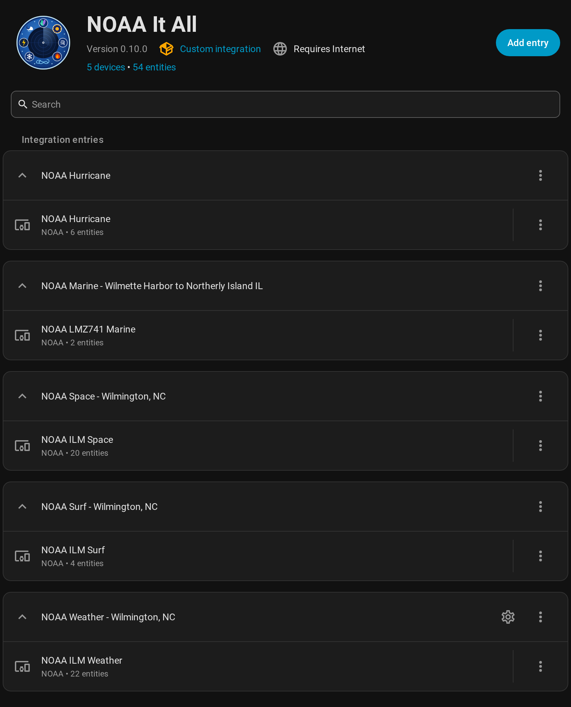
</p>

#### Add a location

1. Go to **Settings** → **Devices & services** → **Add integration**, search for "NOAA It All", and choose **Weather for a location**.

   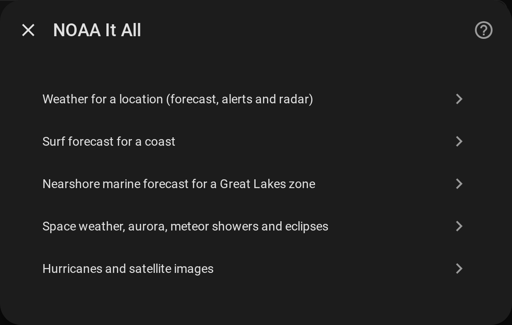

2. Enter the **latitude and longitude** (required). They're pre-filled from your Home Assistant Home zone; change them to use another location. Observations come from the NWS station nearest to them, and alerts, forecasts and cloud cover use them too, as does the Space entry added in step 5.

   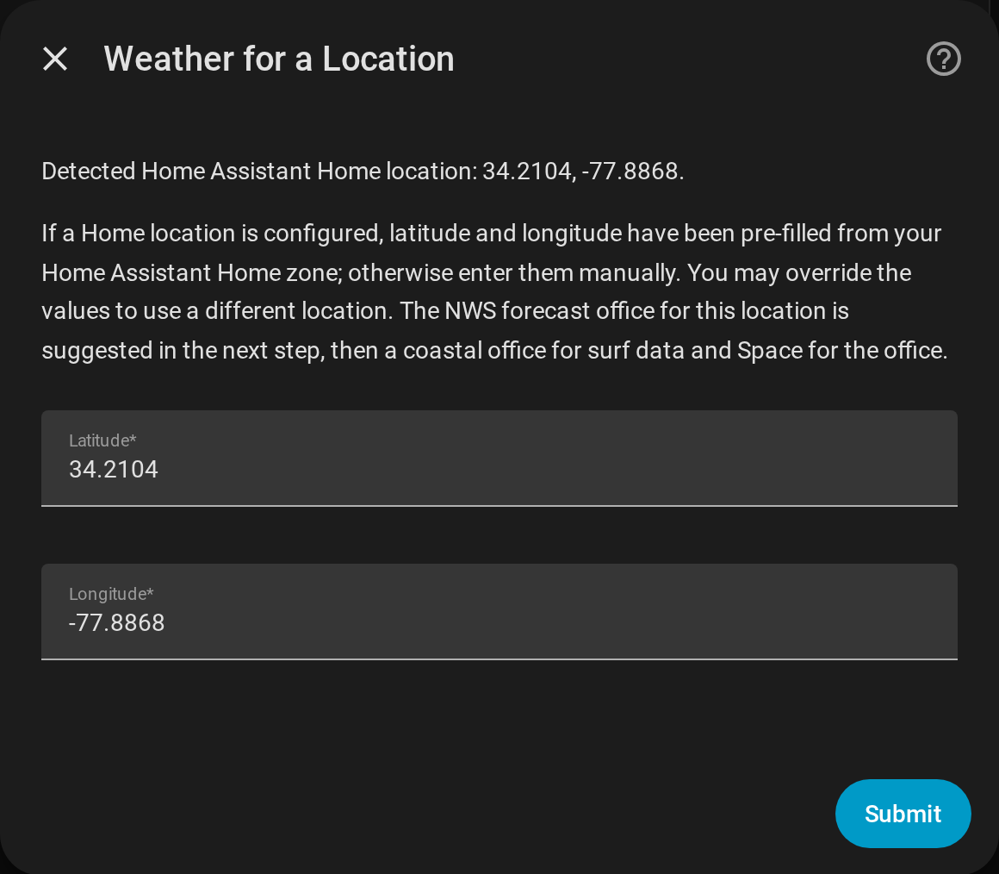

3. Select your **NWS Forecast Office**. The office NWS names for your location is pre-selected (e.g., ILM for Wilmington, VEF for Las Vegas, BOU for Denver), followed by any coastal offices within 50 miles. If NWS can't be reached, only coastal offices are listed.

   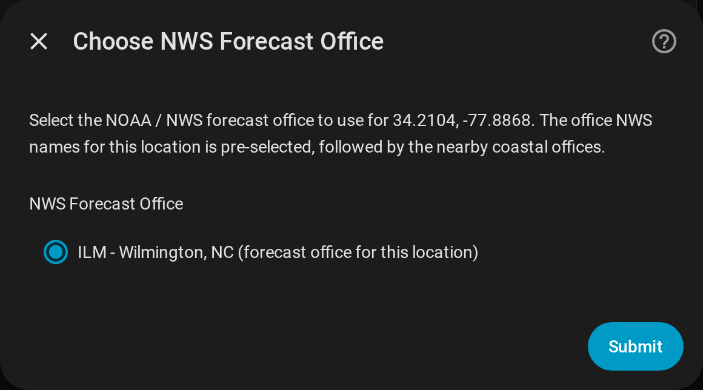

4. Choose a **surf forecast office**. Only coastal offices issue Surf Zone Forecasts, so this is the coast whose rip current risk, surf height and water temperature you want, added as its own `NOAA Surf` entry. The nearest is pre-selected; pick another to follow a beach you visit, or choose **No surf data**. Each office is listed with its distance and what it provides, e.g. `ILM - Wilmington, NC (4.0 mi) - rip current, water temp, surf height`:
   - Every office gives rip current risk. Water temperature needs a tide station and surf height a buoy; a new surf entry for an office without one doesn't get that entity, so nothing sits at unknown. See [NWS Forecast Offices](#nws-forecast-offices) for which offices have which.
   - **no forecast this week** means NWS hasn't issued one for that office in the last 7 days. Some offices, such as the Great Lakes ones, only issue them in their summer season.
   - **already added** means another entry already uses that office's surf entry, which is shared rather than added twice.

   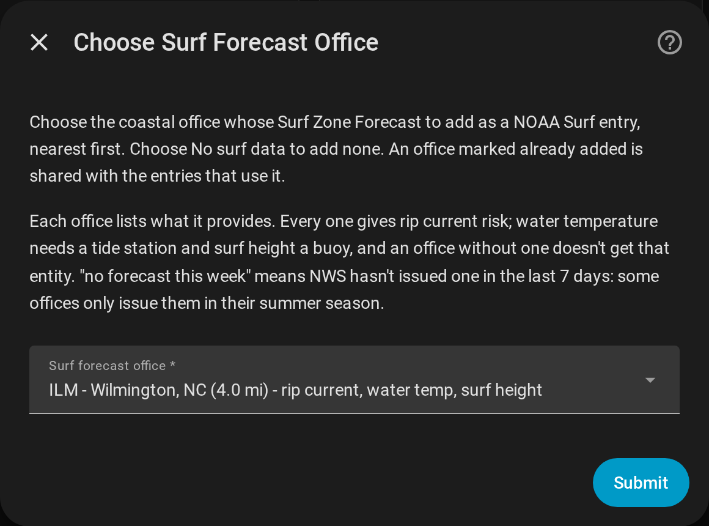

5. Choose **Space**: space weather, aurora, meteor showers and eclipses, as a `NOAA Space` entry for the forecast office, with a device named after it. `NOAA ILM Space - this location` adds it, worked out for this location. Each office has one Space entry:
   - **already added** means the office has one already. The location shares it, and it stays at its own location.
   - The other offices' Space entries are listed as **already added** too. Choosing one, or **No space data**, adds nothing.

   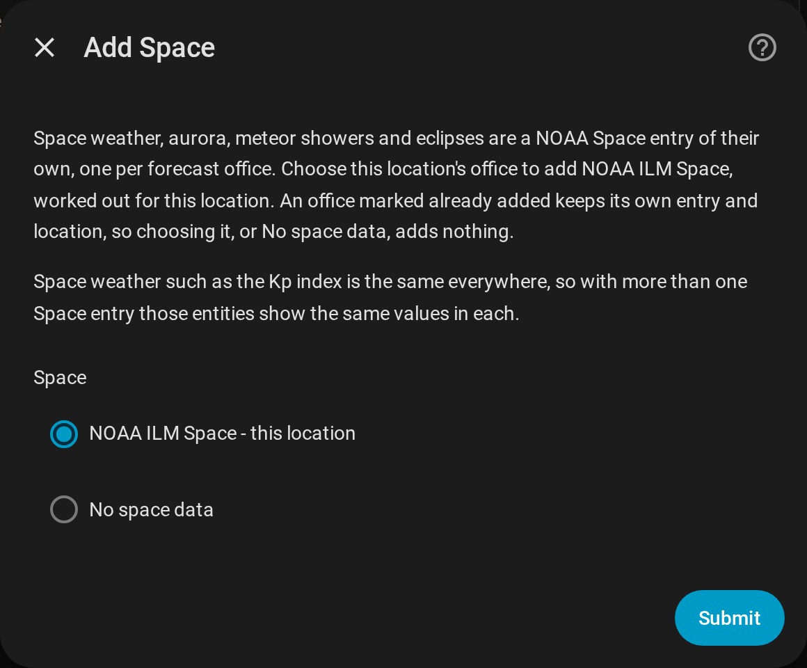

6. Assign the device to an area, or choose **Skip and finish**. A weather entry has one device, `NOAA ILM Weather`. The surf and Space entries, and the hurricane entry on a first setup, are added alongside it.

   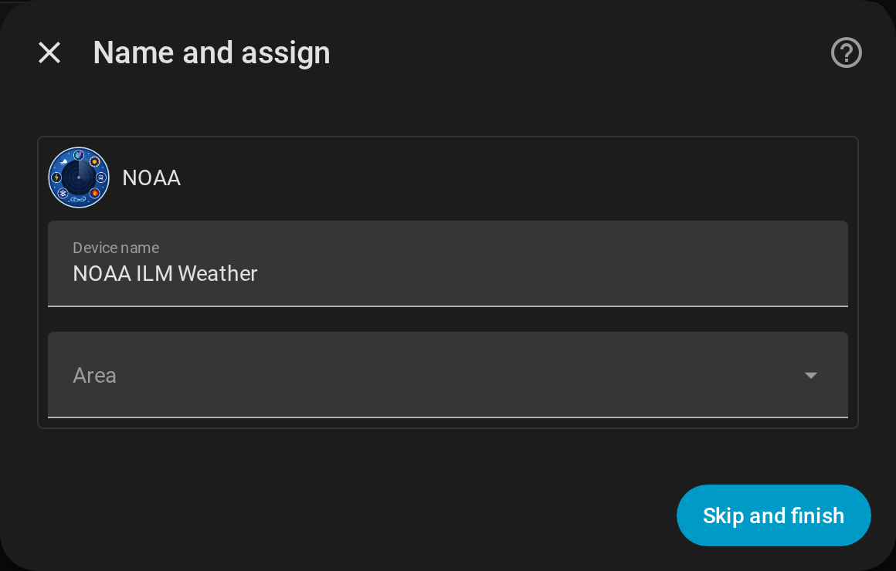

A location set up as the integration's first entry also adds the `NOAA Hurricane` entry. Delete it if you don't want hurricane and satellite entities; nothing adds it back.

#### Add more beaches, marine zones, Space or hurricanes

Use **Add entry** on the NOAA It All page and pick from the same menu. **Hurricanes and satellite images** is only offered while there's no `NOAA Hurricane` entry.

- **Surf forecast for a coast** lists every coastal office that doesn't have a surf entry yet, nearest to your Home zone first.

  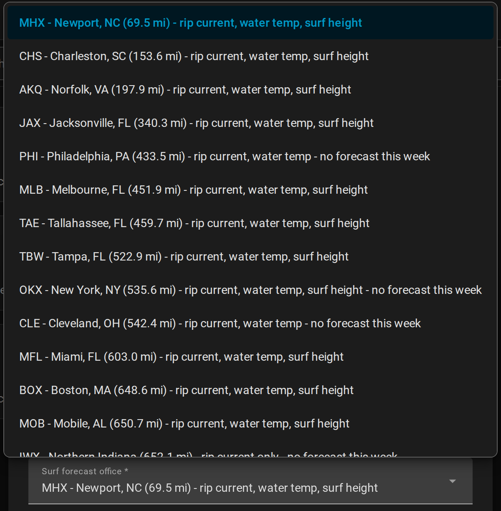

- **Nearshore marine forecast for a Great Lakes zone** takes an NWS marine zone ID such as `LMZ741`. NWS supplies the zone's office and name, and setup checks the zone is in that office's Nearshore Marine Forecast. To find a zone ID, open the zone's [marine forecast](https://forecast.weather.gov/shmrn.php?mz=lmz741) on weather.gov; the ID is in the page address (`mz=lmz741`). Open-lake and ocean zones aren't covered.

  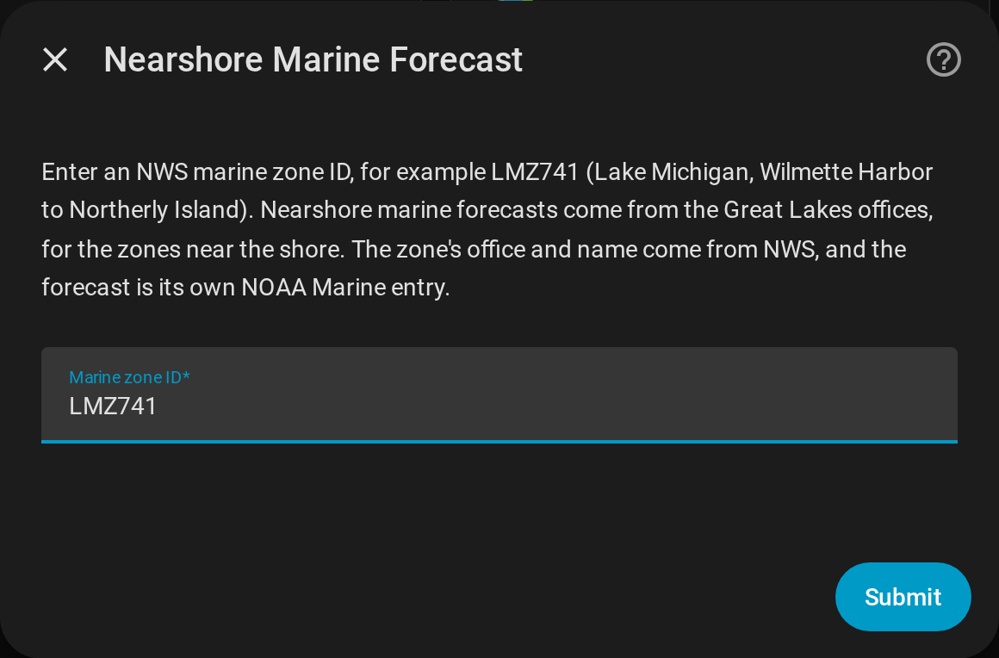

- **Space weather, aurora, meteor showers and eclipses** asks for a location, pre-filled from your Home zone, then its forecast office. Use it for aurora, meteor showers and eclipses somewhere other than your weather locations, such as a cabin near Marquette (`NOAA Space - Marquette, MI`, device `NOAA MQT Space`). Each office has one Space entry, so an office that has one is refused. So is a location NWS doesn't name an office for, as when NWS is down: try again later.

#### Change a location

**Configure** (the gear on a `NOAA Weather` entry) walks through the latitude and longitude, the forecast office, then how many hours the radar loop covers (see [Radar loop history](#image-entities)). Surf, marine, Space and hurricane entries have nothing to configure: add or delete them instead. A Space entry doesn't move with a weather entry; for a new office, add Space there and delete the old one.

<p align="left">
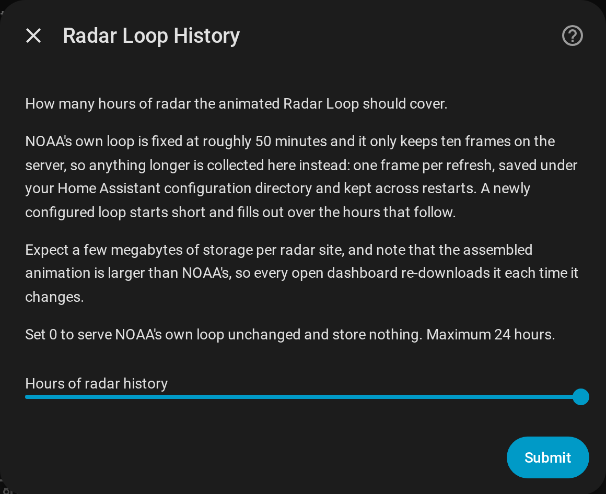
</p>

#### Upgrading from 0.9.x

Upgrading moves each weather entry's `NOAA {OFFICE} Space` device into a `NOAA Space` entry for its office, at that entry's location, keeping the entity IDs and history. Weather entries in the same office share one Space entry. Going back to 0.9.x afterwards needs the integration removed and added again.

#### Upgrading from 0.7.x

Upgrading splits each existing entry once: the location becomes a `NOAA Weather` entry, and its surf and the hurricane entities move to their own entries, keeping their entity IDs and history. Every surf entity you had is kept, including Water Temperature or Surf Height read from the forecast text where the office has no station. Reload the Home Assistant page afterwards so the new setup screens show. Going back to 0.7.x afterwards needs the integration removed and added again.

#### Legacy YAML Configuration

> **Removed.** YAML configuration is no longer supported and creates **no entities**. If
> `noaa_it_all:` is present in `configuration.yaml`, the integration logs an error and sets nothing
> up. Remove the block and add the integration through **Settings → Devices & services → Add
> Integration → NOAA It All**.

## Device Grouping and Organization

Every entity belongs to one of five kinds of device, one for each kind of entry. The screenshots below are from a Wilmington, NC (ILM) setup.

### Device Groups Overview

#### 📍 NOAA {OFFICE} Weather
Location-specific weather observations, forecasts, alerts and radar, in the `NOAA Weather - <office>` entry
- **Device ID**: `noaa_{office}_weather` (e.g., `noaa_ILM_weather`)
- **Location**: Your configured NWS office and coordinates
- **Update Frequency**: 10 minutes
- **Entities**: 22: nine observations, two forecasts, the weather entity, Active NWS Alerts and four alert binary sensors, cloud cover, the forecast discussion, and the radar timestamp, image and loop

<p align="left">
  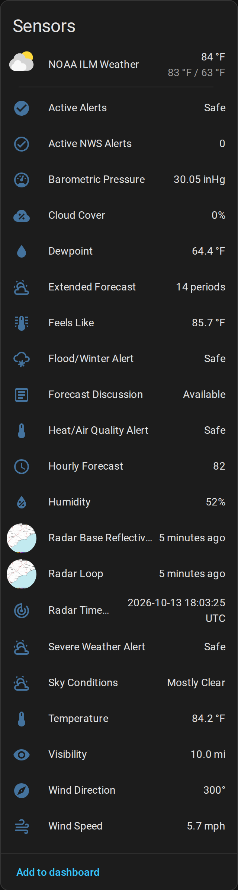
</p>

#### 🌌 NOAA {OFFICE} Space
Space weather (geomagnetic storms, Kp, aurora, solar radiation storms) plus the meteor shower and eclipse forecasts, in the office's `NOAA Space - <office>` entry
- **Device ID**: `noaa_{office}_space` (e.g., `noaa_ILM_space`)
- **Location**: Space weather is global; aurora, meteor shower and eclipse entities use the Space entry's location
- **More than one Space entry**: space weather is the same everywhere, so these show the same values in each: Planetary K-index and its rating, Geomagnetic Storm and its interpretation, Solar Radiation Storm Alerts, and the Geoelectric Field and Aurora Forecast images. Aurora, meteor shower and eclipse entities are worked out for each entry
- **Update Frequency**: 10 minutes for space weather and its images, 30 minutes for meteor showers. Eclipses recompute hourly, every 5 minutes in the 6 hours before one, and every minute while one is under way
- **Entities**: 20: eight space weather sensors, three meteor shower and four eclipse sensors, three binary sensors, and two images

<p align="left">
  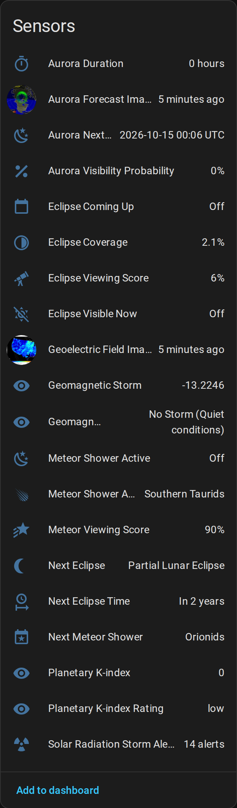
</p>

#### 🌊 NOAA {OFFICE} Surf
Rip current risk, surf height and water temperature for one coastal office, in its `NOAA Surf - <office>` entry
- **Device ID**: `noaa_{office}_surf` (e.g., `noaa_ILM_surf`)
- **Location**: The coastal office's surf zones. A new surf entry only gets Water Temperature and Surf Height where the office has a tide station or buoy
- **Update Frequency**: 10 minutes
- **Entities**: 2 to 4: Rip Current Risk and Unsafe to Swim, plus Water Temperature and Surf Height where available

<p align="left">
  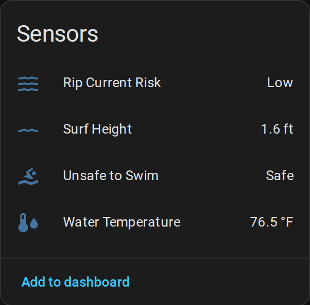
</p>

#### ⛵ NOAA {ZONE} Marine
The nearshore marine forecast for one Great Lakes marine zone, in its `NOAA Marine - <zone name>` entry
- **Device ID**: `noaa_{ZONE}_marine` (e.g., `noaa_LMZ741_marine`)
- **Location**: The marine zone
- **Update Frequency**: 10 minutes
- **Entities**: `sensor.noaa_{zone}_marine_period` and `sensor.noaa_{zone}_marine_forecast`

<p align="left">
  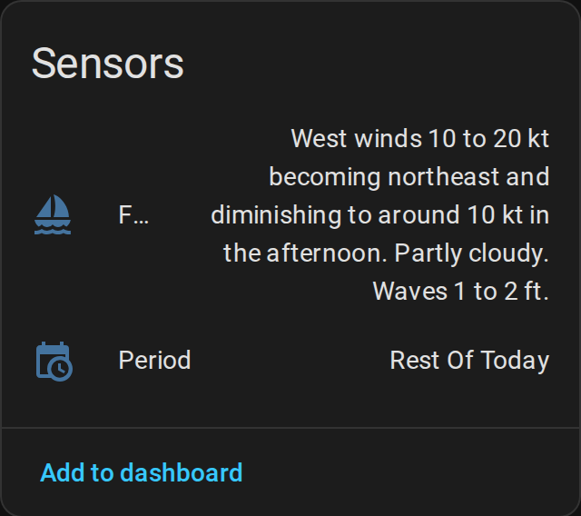
</p>

#### 🌀 NOAA Hurricane
Global hurricane tracking and GOES satellite imagery, in the `NOAA Hurricane` entry
- **Device ID**: `noaa_hurricane`
- **Location**: Independent (global NHC/GOES data)
- **Update Frequency**: 10 minutes
- **Entities**: `sensor.noaa_hurricane_activity`, `sensor.noaa_hurricane_alerts`, `image.noaa_hurricane_outlook_image`, `image.noaa_hurricane_pacific_outlook_image`, `image.noaa_hurricane_goes_air_mass`, `image.noaa_hurricane_goes_geocolor`

<p align="left">
  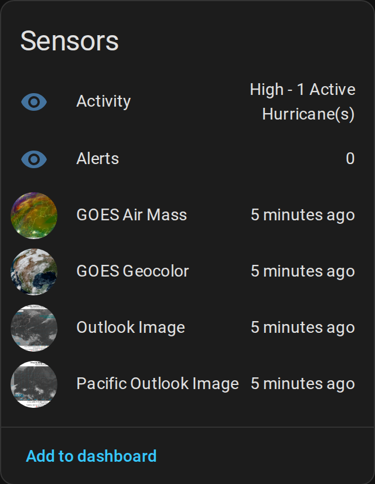
</p>

> **Important**: Hurricane and GOES satellite entities live under **NOAA Hurricane** only, in its own entry. There is one, however many locations are configured.

> **Tip**: Under **Settings → Devices & services**, click any NOAA device to see its entities together. This makes it easy to create dashboard cards and automations for specific categories of data.

## Available Entities

### Entity Reference

Every entity, as created for the Wilmington (ILM) office and the `LMZ741` marine zone. Replace `ilm` with your office code and `lmz741` with your zone, in lower case. The sections after the tables describe each group in detail.

**NOAA {OFFICE} Weather** (22)

| Entity ID | State |
|---|---|
| `weather.noaa_ilm_weather` | Weather entity: condition, temperature and forecasts |
| `sensor.noaa_ilm_weather_temperature` | °F |
| `sensor.noaa_ilm_weather_feels_like` | °F, heat index or wind chill |
| `sensor.noaa_ilm_weather_humidity` | % |
| `sensor.noaa_ilm_weather_dewpoint` | °F |
| `sensor.noaa_ilm_weather_wind_speed` | mph |
| `sensor.noaa_ilm_weather_wind_direction` | Degrees; `cardinal_direction` attribute |
| `sensor.noaa_ilm_weather_barometric_pressure` | inHg |
| `sensor.noaa_ilm_weather_visibility` | mi |
| `sensor.noaa_ilm_weather_sky_conditions` | Text, e.g. `Mostly Clear` |
| `sensor.noaa_ilm_weather_cloud_cover` | % |
| `sensor.noaa_ilm_weather_extended_forecast` | Number of periods, e.g. `14 periods` |
| `sensor.noaa_ilm_weather_hourly_forecast` | This hour's forecast temperature |
| `sensor.noaa_ilm_weather_forecast_discussion` | `Available`; text in attributes |
| `sensor.noaa_ilm_weather_active_nws_alerts` | Number of active alerts |
| `sensor.noaa_ilm_weather_radar_timestamp` | Time of the latest radar image |
| `binary_sensor.noaa_ilm_weather_severe_weather_alert` | On (Unsafe) during a severe weather alert |
| `binary_sensor.noaa_ilm_weather_flood_winter_alert` | On (Unsafe) during a flood or winter alert |
| `binary_sensor.noaa_ilm_weather_heat_air_quality_alert` | On (Unsafe) during a heat, air quality or fire alert |
| `binary_sensor.noaa_ilm_weather_active_alerts` | On (Unsafe) during any alert |
| `image.noaa_ilm_weather_radar_base_reflectivity` | Time of the image |
| `image.noaa_ilm_weather_radar_loop` | Time of the image |

**NOAA {OFFICE} Space** (20)

| Entity ID | State |
|---|---|
| `sensor.noaa_ilm_space_planetary_k_index` | Kp, 0–9 |
| `sensor.noaa_ilm_space_planetary_k_index_rating` | `low` (Kp under 2), `moderate` (2 to under 5) or `high` |
| `sensor.noaa_ilm_space_geomagnetic_storm` | Dst index in nT, e.g. `-13.2` |
| `sensor.noaa_ilm_space_geomagnetic_storm_interpretation` | `No Storm (Quiet conditions)`, `Minor Storm`, `Moderate Storm`, `Strong Storm` or `Severe Storm` |
| `sensor.noaa_ilm_space_aurora_visibility_probability` | % |
| `sensor.noaa_ilm_space_aurora_next_time` | Estimated start, e.g. `2026-10-15 00:06 UTC` |
| `sensor.noaa_ilm_space_aurora_duration` | Hours |
| `sensor.noaa_ilm_space_solar_radiation_storm_alerts` | Number of SWPC alerts |
| `sensor.noaa_ilm_space_meteor_shower_activity` | Shower most worth watching now, or `None` |
| `sensor.noaa_ilm_space_next_meteor_shower` | Next shower to peak |
| `sensor.noaa_ilm_space_meteor_viewing_score` | % |
| `binary_sensor.noaa_ilm_space_meteor_shower_active` | On when a shower is worth going out for |
| `sensor.noaa_ilm_space_next_eclipse` | Next eclipse visible here, e.g. `Partial Lunar Eclipse` |
| `sensor.noaa_ilm_space_next_eclipse_time` | Timestamp: when to go outside |
| `sensor.noaa_ilm_space_eclipse_coverage` | % of the disc covered |
| `sensor.noaa_ilm_space_eclipse_viewing_score` | % |
| `binary_sensor.noaa_ilm_space_eclipse_visible_now` | On from an hour before first contact to last contact |
| `binary_sensor.noaa_ilm_space_eclipse_coming_up` | On two weeks before an eclipse worth planning for |
| `image.noaa_ilm_space_geoelectric_field_image` | Time of the image |
| `image.noaa_ilm_space_aurora_forecast_image` | Time of the image |

**NOAA {OFFICE} Surf** (2 to 4)

| Entity ID | State |
|---|---|
| `sensor.noaa_ilm_surf_rip_current_risk` | `Low`, `Moderate` or `High` |
| `binary_sensor.noaa_ilm_surf_unsafe_to_swim` | On (Unsafe) when the rip current risk is high |
| `sensor.noaa_ilm_surf_water_temperature` | °F, if the office has a tide station |
| `sensor.noaa_ilm_surf_surf_height` | ft, if the office has a buoy |

**NOAA {ZONE} Marine** (2)

| Entity ID | State |
|---|---|
| `sensor.noaa_lmz741_marine_period` | Current forecast period, e.g. `Rest Of Today` |
| `sensor.noaa_lmz741_marine_forecast` | That period's forecast text |

**NOAA Hurricane** (6)

| Entity ID | State |
|---|---|
| `sensor.noaa_hurricane_activity` | Activity level, e.g. `Quiet - No Active Storms or Alerts` |
| `sensor.noaa_hurricane_alerts` | Number of hurricane and tropical storm watches and warnings |
| `image.noaa_hurricane_outlook_image` | Time of the image (Atlantic) |
| `image.noaa_hurricane_pacific_outlook_image` | Time of the image (East Pacific) |
| `image.noaa_hurricane_goes_air_mass` | Time of the image |
| `image.noaa_hurricane_goes_geocolor` | Time of the image |

### Space Weather and Hurricane Sensors
- **Planetary K-index**: NOAA SWPC's estimated planetary Kp, from its 1-minute feed *(NOAA Space)*
- **Geomagnetic Storm**: The Dst index in nT, hourly from SWPC; the more negative, the stronger the storm *(NOAA Space)*
- **Hurricane Alerts**: Number of active NWS hurricane and tropical storm warnings and watches *(NOAA Hurricane)*
- **Hurricane Activity**: Overall activity from the NWS alerts and the NHC's active storms. The state starts with the level, `Quiet`, `Low`, `Moderate` or `High`, followed by the reason, e.g. `High - 1 Active Hurricane(s)`. The `storm_details` attribute lists each active storm with its classification, intensity, position and movement *(NOAA Hurricane)*

### Surf Sensors
For the coastal office of a `NOAA Surf` entry *(NOAA {OFFICE} Surf)*:
- **Rip Current Risk**: Risk level (Low, Moderate, High) from the office's Surf Zone Forecast
- **Unsafe to Swim**: Binary sensor that turns on when the Surf Zone Forecast gives a high rip current risk; the `risk_level` attribute has the level
- **Water Temperature**: Water temperature in °F from the office's NOAA tide station. Only created for offices with one
- **Surf Height**: Wave height in feet from the office's NDBC buoy. Only created for offices with one

Rip Current Risk and Unsafe to Swim are `unknown` while the Surf Zone Forecast can't be fetched, rather than reading as safe. An entry upgraded from 0.7.x keeps any Water Temperature or Surf Height it had, read from the forecast text where the office has no station.

### Nearshore Marine Forecast
For the marine zone of a `NOAA Marine` entry, for example `LMZ741` on Lake Michigan *(NOAA {ZONE} Marine)*:
- **Period**: The current forecast period, such as `Rest Of Today` *(sensor.noaa_{zone}_marine_period)*
- **Forecast**: That period's forecast, such as `West winds 10 to 20 kt becoming northeast. Partly cloudy. Waves 1 to 2 ft.` *(sensor.noaa_{zone}_marine_forecast)*. The `periods` attribute lists every period as `name` and `detailed_forecast`, with any advisories in `headlines`

If the office hasn't issued a forecast in 24 hours, both are unavailable rather than showing an old one. The forecasts come from the Great Lakes offices' Nearshore Marine Forecast (NSH).

### NWS Active Weather Alerts
Real-time monitoring of National Weather Service alerts for your location *(NOAA {OFFICE} Weather)*:

**Binary Sensors:**
- **Severe Weather Alert**: Active tornado, thunderstorm, hurricane, or extreme wind warnings/watches *(binary_sensor.noaa_{office}_weather_severe_weather_alert)*
- **Flood/Winter Alert**: Active flood, winter storm, snow, ice, or freezing rain warnings/watches *(binary_sensor.noaa_{office}_weather_flood_winter_alert)*
- **Heat/Air Quality Alert**: Active heat, air quality, fire weather, or environmental advisories *(binary_sensor.noaa_{office}_weather_heat_air_quality_alert)*
- **Active Alerts**: General indicator for any active NWS alerts *(binary_sensor.noaa_{office}_weather_active_alerts)*

Each has `alert_count` and an `alerts` list with each alert's `event`, `headline`, `severity`, `urgency`, `certainty`, `area`, `effective`, `expires` and `description`. They use the `safety` device class, so Home Assistant shows them as **Safe** or **Unsafe**.

**Comprehensive Sensor:**
- **Active NWS Alerts**: The number of active alerts *(sensor.noaa_{office}_weather_active_nws_alerts)*, with:
  - `alert_count` and an `alerts` list with each alert's headline, description and instructions
  - `summary`: counts of warnings, watches, advisories and statements, and counts `by_severity` (Extreme, Severe, Moderate, Minor) and `by_urgency` (Immediate, Expected, Future)

> **Note**: Alert sensors update every 10 minutes and only include actual alerts (excludes test messages and drafts). All alerts are filtered to your configured latitude and longitude. The binary sensors and the comprehensive sensor are all on the NOAA {OFFICE} Weather device.

### Current Weather Conditions
Real-time weather observations from your local NWS observation station *(NOAA Weather)*:
- **Temperature**: Current temperature in °F *(sensor.noaa_{office}_weather_temperature)*
- **Humidity**: Relative humidity percentage *(sensor.noaa_{office}_weather_humidity)*
- **Wind Speed**: Wind speed in mph *(sensor.noaa_{office}_weather_wind_speed)*
- **Wind Direction**: Wind direction in degrees with cardinal direction *(sensor.noaa_{office}_weather_wind_direction)*
- **Barometric Pressure**: Barometric pressure in inHg *(sensor.noaa_{office}_weather_barometric_pressure)*
- **Dewpoint**: Dewpoint temperature in °F *(sensor.noaa_{office}_weather_dewpoint)*
- **Visibility**: Visibility distance in miles *(sensor.noaa_{office}_weather_visibility)*
- **Sky Conditions**: Current sky conditions description (Clear, Cloudy, Fog, etc.) *(sensor.noaa_{office}_weather_sky_conditions)*
- **Feels Like**: Apparent temperature incorporating wind chill or heat index *(sensor.noaa_{office}_weather_feels_like)*

> **Note**: Weather observations update every 10 minutes from the NWS observation station nearest your configured coordinates. If that station stops answering, or has nothing from the last two hours, the next nearest (of up to three) is used until it comes back; the `station_id` attribute shows which one. Data includes automatic unit conversions to US customary units.
>
> A missed reading doesn't blank a sensor. If NWS leaves a field such as humidity or wind out of the newest observation, it comes from the newest one in the last two hours that has it, and that sensor's `timestamp` attribute says when it was observed. If every station fails, the last observation stays for up to an hour after the last successful refresh before the observation entities go `unavailable`. Wind direction, wind chill and heat index come from the same observation as the wind speed or temperature they go with: NWS leaves direction empty for calm or variable wind, and wind chill and heat index whenever they don't apply.

### Aurora Visibility Alerts
Location-aware aurora visibility predictions *(NOAA Space)*:
- **Aurora Next Time**: Predicted timing when aurora activity may begin at your location *(sensor.noaa_{office}_space_aurora_next_time)*
- **Aurora Duration**: Estimated length of aurora visibility in hours based on geomagnetic conditions *(sensor.noaa_{office}_space_aurora_duration)*
- **Aurora Visibility Probability**: Percentage chance of aurora visibility from your specific location *(sensor.noaa_{office}_space_aurora_visibility_probability)*

> **Note**: Aurora predictions are based on real-time Kp index data and the magnetic latitude of the Space entry's office (for the coastal offices) or of its location (for any other office). Northern locations (like Duluth, MN) have much higher visibility potential than southern locations (like Miami, FL).

### Solar Radiation Storm Alerts
Location-aware monitoring of solar radiation storm activity *(NOAA Space)*:
- **Solar Radiation Storm Alerts**: The number of current SWPC alerts, with solar radiation storms classified S1-S5 *(sensor.noaa_{office}_space_solar_radiation_storm_alerts)*
  - **Storm Classification**: Automatic detection and classification of solar radiation storms (S1-S5 scale)
  - **Expected Timing**: Start and end times for radiation storm events when available
  - **Impact Assessment**: Potential impacts including satellite interference, radio blackouts, and radiation exposure risks
  - **Location Risk**: Risk assessment based on your magnetic latitude and current storm activity
  - **Real-time Alerts**: Live monitoring of NOAA Space Weather Prediction Center alerts

> **Note**: Solar radiation storm impacts vary by location and magnetic latitude. Higher latitudes (like Alaska and northern Canada) experience more severe effects, while equatorial regions are generally less affected. The integration provides location-specific risk assessments for your configured NWS office.

### Meteor Showers
Meteor shower alerts and a viewing forecast for your exact location *(NOAA Space)*:

- **Meteor Shower Activity**: The shower most worth watching right now, or `None` *(sensor.noaa_{office}_space_meteor_shower_activity)*
  - Attributes include the current ZHR, peak time in your local timezone, radiant altitude, parent body, and a list of every shower currently active
- **Next Meteor Shower**: The next shower to reach maximum *(sensor.noaa_{office}_space_next_meteor_shower)*
  - The `upcoming` attribute holds the next five showers with peak dates — this is what dashboard "what's coming up" cards read from
- **Meteor Viewing Score**: How good tonight's sky is, 0–100% *(sensor.noaa_{office}_space_meteor_viewing_score)*
  - Attributes include `rating`, `best_window_start`/`best_window_end` (when to actually go outside), `expected_per_hour`, `moon_illumination`, `moon_altitude`, `darkness`, and `limiting_factor`
- **Meteor Shower Active**: Turns on when a shower is genuinely worth going outside for *(binary_sensor.noaa_{office}_space_meteor_shower_active)*
  - Requires both a real predicted rate (≥5/hour) and usable sky conditions (score ≥25), so it stays off most nights instead of sitting permanently on
  - Measured over 2026 from Wilmington NC that is about 50 nights, clustered around the major showers (~13 for the Perseids, 8 for the Orionids, 7 for the Geminids) — the Perseids really do stay above 5/hour for roughly six days either side of maximum

> **Note on the data source**: NOAA publishes no meteor shower data, and neither does anyone else as a live feed — none is needed. Earth crosses the same debris streams at the same point in its orbit every year, so this feature ships a catalog of ~29 showers keyed by **solar longitude** and computes each year's peak time locally. There is no API call, no API key, and no extra dependency, and it keeps working with no internet connection. Computed peak times are accurate to about ±11 minutes, which is far finer than the hours-wide spread of real shower maxima.

> **Note on the score**: The viewing score measures *sky conditions*, not shower strength — it is the fraction of the ideal meteor rate you would actually achieve, so a minor shower riding high under a new moon scores well while the Perseids behind a full moon score badly. Shower strength is reported separately as `expected_per_hour`. The score accounts for radiant altitude, moonlight and astronomical darkness. It does **not** account for cloud cover; pair it with `sensor.noaa_{office}_weather_cloud_cover` if you want that.

### Solar and Lunar Eclipses
Eclipse alerts and a viewing forecast for your exact location *(NOAA Space)*:

- **Next Eclipse**: The next eclipse visible from where you are, named the way *you* will see it *(sensor.noaa_{office}_space_next_eclipse)*
  - Attributes include the local start/maximum/end times, how much of the disc you get, where to look, and an `upcoming` list of the next five
- **Next Eclipse Time**: When to go outside — a real timestamp, so Home Assistant shows "in 3 days" or "8:29 PM" and a time trigger can fire straight off it *(sensor.noaa_{office}_space_next_eclipse_time)*
  - The moment the eclipse has begun **and** the Sun or Moon is above your horizon, which for an eclipse already under way at moonrise is moonrise. Attributes carry the end of the window, maximum, totality window, and `look_towards`
  - `unknown` when no eclipse is due, which for a timestamp is the honest answer
- **Eclipse Coverage**: How much of the Sun or Moon you will actually see covered, 0–100% *(sensor.noaa_{office}_space_eclipse_coverage)*
  - This is the "will I get 29% or the whole thing" number
- **Eclipse Viewing Score**: How worthwhile it is from here, 0–100% *(sensor.noaa_{office}_space_eclipse_viewing_score)*
  - Attributes include `rating`, `watch_from_local`/`watch_until_local`, `look_towards`, the totality window, `limiting_factor`, and the eye-safety notice
- **Eclipse Visible Now**: Turns on an hour before first contact and off at last contact *(binary_sensor.noaa_{office}_space_eclipse_visible_now)*
  - The one to trigger an announcement from. Expect it on for a few hours a year at most, and in many years not at all
- **Eclipse Coming Up**: Turns on two weeks before an eclipse worth planning around *(binary_sensor.noaa_{office}_space_eclipse_coming_up)*
  - A higher bar than the live alert: a partial eclipse worth glancing at is not one worth booking the day off for

> **⚠️ Eye safety**: Never look at a partially eclipsed Sun without ISO 12312-2 eclipse glasses or a certified solar filter — sunglasses, exposed film and smoked glass are **not** safe. Only during **totality**, between second and third contact, may the Sun be viewed with the naked eye, and the filter goes back on the instant the first sliver reappears. An **annular** eclipse is never safe to view unfiltered: there is still a complete ring of photosphere at maximum. Every solar entity carries `eye_protection_required`, `safe_without_filter` and an `eye_safety` string so an automation can read the warning out.

> **Note on "your" eclipse**: A total solar eclipse is total along a strip a couple of hundred kilometres wide and merely partial across a whole continent either side of it. Everything here reports the eclipse **you** get — a 43% partial is reported as a partial eclipse, with the headline classification kept alongside as `global_type`. Likewise `disc_covered`, the viewing score and `look_towards` are all measured at the best moment the Sun or Moon is actually above your horizon, so a site where the body sets mid-eclipse is not advertised a maximum that happens underground, or pointed at a horizon the Moon has already set behind. `visible_fraction` says how much of the event you get at all, and `altitude_at_maximum` still reports the geometric peak for reference.

> **Note on the two percentages**: `disc_covered` is the fraction of the disc's **area** that is hidden. Eclipse *magnitude*, the figure usually quoted, is the fraction of its **diameter**, and the two are far apart — magnitude 0.5 is only 39% covered. Both are reported so you can compare against a published table.

> **Note on the data source**: Lunar eclipses are computed from first principles and stay correct indefinitely. Solar eclipses need Besselian elements from full planetary ephemerides, so this feature bundles NASA's for **2025–2075** — 114 eclipses — and does the observer-specific geometry locally. There is no API call, no API key and no extra dependency, and it keeps working with no internet connection. Computed contact times land within 20 seconds of NASA's published values, checked against all 114. Regenerate or extend the catalog with `python3 scripts/build_eclipse_catalog.py`. *Eclipse Predictions by Fred Espenak, NASA's GSFC.*

> **Note on the score**: Unlike the meteor viewing score this deliberately does **not** factor out the strength of the event — whether the Moon covers a tenth of the Sun or all of it is the single most important thing about a solar eclipse. It accounts for how much is covered, how high the Sun or Moon sits, and for lunar eclipses how dark the sky is. It does **not** account for cloud cover; pair it with `sensor.noaa_{office}_weather_cloud_cover` if you want that.

### Optional Secondary Sensors
These sensors provide additional weather data where available from NOAA/NWS *(NOAA Weather)*:

- **Cloud Cover**: Current cloud coverage percentage from NWS gridpoint data *(sensor.noaa_{office}_weather_cloud_cover)*
  - Returns percentage (0-100%) of sky covered by clouds
  - Updated from forecast gridpoint data for your location
  - Requires latitude/longitude configuration
  - May not be available for all locations

- **Radar Timestamp**: Timestamp of the latest radar image for your NWS office *(sensor.noaa_{office}_weather_radar_timestamp)*
  - Shows when the most recent radar image was captured
  - Useful for automations or displaying radar freshness
  - Based on the NEXRAD radar site for your location, which NWS names during setup
  - Not created if no radar site is known for the office

- **Forecast Discussion**: Meteorologist-written forecast discussion (AFD product) *(sensor.noaa_{office}_weather_forecast_discussion)*
  - Detailed technical analysis from local NWS meteorologists
  - Includes reasoning behind forecast decisions
  - Updated when new forecast discussions are issued (typically 2-3 times daily)
  - State is the literal `Available` (or unknown); the text is in the `full_text` attribute,
    and `summary` has its first 200 characters. `issue_time` is when it was issued, e.g.
    `235 PM EDT Tue Oct 13 2026`
  - Provides insight into weather patterns and forecast confidence

### Forecast Sensors and the Weather Entity

- **Extended Forecast**: Multi-day NWS forecast *(sensor.noaa_{office}_weather_extended_forecast)*.
  The state is the number of periods; the `periods` attribute lists each one with `name`,
  `start_time`, `temperature`, `temperature_unit`, `wind_speed`, `wind_direction`,
  `short_forecast`, `detailed_forecast` and `icon`
- **Hourly Forecast**: Hour-by-hour NWS forecast *(sensor.noaa_{office}_weather_hourly_forecast)*.
  The state is this hour's temperature; `current_hour` has this hour and `hourly_periods` the
  next 48, each with `precipitation_probability` as well
- **Weather**: A full Home Assistant weather entity backed by NWS observations and forecasts
  *(weather.noaa_{office}_weather)* — use this with the standard Weather Forecast card, and with
  `weather.get_forecasts` in templates. Note the single `weather` in the ID, not `_weather_weather`.

### Derived Space Weather Sensors

- **Geomagnetic Storm Interpretation**: Plain-language reading of the Dst value
  *(sensor.noaa_{office}_space_geomagnetic_storm_interpretation)*
- **Planetary K-Index Rating**: Plain-language reading of the Kp value
  *(sensor.noaa_{office}_space_planetary_k_index_rating)*

> **Note**: These sensors gracefully handle missing data by returning `None` or `Unknown` when data is unavailable. The `availability` attribute indicates data source and current status. **UV Index is NOT available** through NWS APIs and cannot be provided by this integration.

### Image Entities
Visual representations of current conditions:

**NOAA {OFFICE} Space** (global images, one set per Space entry):
- **Geoelectric Field Image** — Real-time geoelectric field map from SWPC *(image.noaa_{office}_space_geoelectric_field_image)*
- **Aurora Forecast Image** — SWPC's aurora forecast map for the northern hemisphere *(image.noaa_{office}_space_aurora_forecast_image)*

**NOAA Hurricane** (global, created once):
- **Outlook Image** — 2-day tropical weather outlook from NHC, **Atlantic basin** *(image.noaa_hurricane_outlook_image)*
- **Pacific Outlook Image** — the same 2-day outlook for the **East Pacific basin** *(image.noaa_hurricane_pacific_outlook_image)*
- **GOES Air Mass** — GOES-19 Air Mass RGB satellite imagery *(image.noaa_hurricane_goes_air_mass)*
- **GOES Geocolor** — GOES-19 GeoColor satellite imagery *(image.noaa_hurricane_goes_geocolor)*

**NOAA {OFFICE} Weather** (one set per weather entry):
- **Radar Base Reflectivity** — Latest NEXRAD base reflectivity radar for your NWS office *(image.noaa_{office}_weather_radar_base_reflectivity)*
- **Radar Loop** — Animated NEXRAD radar loop, covering up to 24 hours *(image.noaa_{office}_weather_radar_loop)*

> **Radar loop history**: NOAA's own radar animation is fixed at ten frames covering roughly 50 minutes, and only those ten frames exist on its server — a longer loop cannot simply be downloaded. So the integration collects one frame per refresh and assembles the animation itself. The window defaults to **24 hours** and is set with **Configure** on the `NOAA Weather` entry (see [Change a location](#change-a-location)); set it to `0` to serve NOAA's 50-minute loop unchanged and store nothing.
>
> Worth knowing before you turn it up:
>
> - **It fills in over time.** A newly configured loop starts at whatever history has been collected so far and reaches its full length after that many hours of uptime. Until there are enough frames, the card shows NOAA's own loop instead, so it is never blank.
> - **Frames survive restarts.** They are stored under `<config>/noaa_it_all/radar_frames/<RADAR_SITE>/`, so a restart does not send the loop back to the beginning. Budget a few megabytes per radar site; the directory is deleted if you remove the integration.
> - **The animation is bigger than NOAA's.** A 24-hour loop is sampled down to 72 frames (one every 20 minutes) and plays through in about ten seconds, but it is still a larger file that every open dashboard re-downloads whenever it changes. Shorter windows are proportionally finer: a 6-hour loop keeps one frame per scan.
>
> The entity's `loop_mode` attribute reports whether you are looking at a locally built animation (`local`) or NOAA's (`upstream`), alongside `frame_count`, `window_start` and `window_end`.

> **Tip**: Image entities can be displayed on dashboards using the standard `picture-entity` or `picture-glance` cards.
>
> Home Assistant fetches each image from NOAA in the background every 10 minutes and serves it to the browser through its own image proxy (`/api/image_proxy/...`), so the dashboard does not talk to NOAA directly. The most recently fetched frame is kept in memory: if NOAA is briefly unreachable the card keeps showing the last good image rather than going blank, and the outage is logged quietly unless it persists. Each entity's state is the timestamp of the image currently being served, so you can alert on an image going stale.

## NWS Forecast Offices

**Weather** works with any NWS forecast office. Setup asks NWS which office covers your location and pre-selects it, so an inland location such as Las Vegas gets its own office (VEF), radar site and forecast discussion.

**Surf** comes from the 36 coastal offices that issue Surf Zone Forecasts. Every one gives rip current risk; water temperature needs a NOAA tide station and surf height an NDBC buoy:

| Office | Code | Water temperature | Surf height |
|---|---|---|---|
| Boston, MA | `BOX` | ✓ | ✓ |
| Brownsville, TX | `BRO` | ✓ | — |
| Caribou, ME | `CAR` | ✓ | — |
| Charleston, SC | `CHS` | ✓ | ✓ |
| Chicago, IL | `LOT` | — | — |
| Cleveland, OH | `CLE` | ✓ | — |
| Corpus Christi, TX | `CRP` | ✓ | ✓ |
| Detroit, MI | `DTX` | — | — |
| Duluth, MN | `DLH` | ✓ | — |
| Eureka, CA | `EKA` | ✓ | ✓ |
| Gaylord, MI | `APX` | — | — |
| Grand Rapids, MI | `GRR` | — | — |
| Green Bay, WI | `GRB` | ✓ | — |
| Guam | `GUM` | ✓ | — |
| Honolulu, HI | `HFO` | ✓ | ✓ |
| Jacksonville, FL | `JAX` | ✓ | ✓ |
| Los Angeles, CA | `LOX` | ✓ | ✓ |
| Marquette, MI | `MQT` | ✓ | — |
| Medford, OR | `MFR` | — | — |
| Melbourne, FL | `MLB` | ✓ | ✓ |
| Miami, FL | `MFL` | ✓ | ✓ |
| Milwaukee, WI | `MKX` | ✓ | — |
| Mobile, AL | `MOB` | ✓ | ✓ |
| New York, NY | `OKX` | ✓ | ✓ |
| Newport, NC | `MHX` | ✓ | ✓ |
| Norfolk, VA | `AKQ` | ✓ | ✓ |
| Northern Indiana | `IWX` | — | — |
| Philadelphia, PA | `PHI` | ✓ | — |
| Portland, ME | `GYX` | ✓ | ✓ |
| Portland, OR | `PQR` | ✓ | ✓ |
| San Diego, CA | `SGX` | ✓ | ✓ |
| San Francisco, CA | `MTR` | ✓ | ✓ |
| San Juan, PR | `SJU` | ✓ | ✓ |
| Tallahassee, FL | `TAE` | ✓ | ✓ |
| Tampa, FL | `TBW` | ✓ | ✓ |
| Wilmington, NC | `ILM` | ✓ | ✓ |

Brownsville has no surf height buoy: the one it shared with Corpus Christi was recovered and no other buoy nearby reports wave height. Some offices, such as the Great Lakes ones, only issue Surf Zone Forecasts in their summer season.

**Nearshore marine forecasts** come from the Great Lakes offices: Buffalo (BUF), Cleveland (CLE), Detroit (DTX), Duluth (DLH), Gaylord (APX), Grand Rapids (GRR), Green Bay (GRB), Marquette (MQT), Milwaukee (MKX), Chicago (LOT) and Northern Indiana (IWX).

## Entity Naming Conventions

Understanding entity naming helps you quickly identify and use sensors in automations and dashboards.

Home Assistant builds each entity ID from the **device name** and the entity's own **name**:
`NOAA ILM Weather` + `Temperature` becomes `sensor.noaa_ilm_weather_temperature`. The six
hurricane entities have no office code, because their device has none, and the marine entities
use the zone instead — see [Exceptions to the pattern](#exceptions-to-the-pattern) below.

**Every example in this document uses the `ILM` office.** To adapt one to your own location,
replace `ilm` with your office code in lower case — and leave the entities listed under
[Exceptions to the pattern](#exceptions-to-the-pattern) alone, because they carry no office code.

### Naming Patterns by Device

| Device | Device Name Pattern | Example Entity ID |
|--------|--------------------|--------------------|
| NOAA Hurricane | `NOAA Hurricane` (global — no office code) | `sensor.noaa_hurricane_activity` |
| NOAA {OFFICE} Weather | `NOAA {OFFICE} Weather` | `sensor.noaa_ilm_weather_visibility` |
| NOAA {OFFICE} Space | `NOAA {OFFICE} Space` | `sensor.noaa_ilm_space_planetary_k_index` |
| NOAA {OFFICE} Surf | `NOAA {OFFICE} Surf` | `sensor.noaa_ilm_surf_rip_current_risk` |
| NOAA {ZONE} Marine | `NOAA {ZONE} Marine` (marine zone, not office) | `sensor.noaa_lmz741_marine_forecast` |

**Examples:**
- `sensor.noaa_ilm_weather_temperature` — Temperature for Wilmington (ILM office)
- `binary_sensor.noaa_ilm_surf_unsafe_to_swim` — Rip current safety for Wilmington
- `sensor.noaa_hurricane_activity` — Global hurricane activity (NOAA Hurricane device)
- `image.noaa_hurricane_outlook_image` — Atlantic hurricane outlook image (NOAA Hurricane device)
- `image.noaa_hurricane_pacific_outlook_image` — East Pacific hurricane outlook image (NOAA Hurricane device)
- `image.noaa_ilm_weather_radar_base_reflectivity` — Radar base reflectivity for Wilmington (ILM)
- `image.noaa_ilm_weather_radar_loop` — Radar loop for Wilmington (ILM)

### Exceptions to the pattern

These six entity IDs do **not** contain an office code, because they live on the shared,
office-independent `NOAA Hurricane` device. When you copy an example and swap the office code,
skip these — substituting into them produces an entity that does not exist:

| Entity ID | Why |
|---|---|
| `sensor.noaa_hurricane_alerts` | Global NHC data, on the shared `NOAA Hurricane` device |
| `sensor.noaa_hurricane_activity` | Global NHC data, on the shared `NOAA Hurricane` device |
| `image.noaa_hurricane_outlook_image` | Global NHC data, on the shared `NOAA Hurricane` device |
| `image.noaa_hurricane_pacific_outlook_image` | Global NHC data, on the shared `NOAA Hurricane` device |
| `image.noaa_hurricane_goes_air_mass` | Global GOES imagery, on the shared `NOAA Hurricane` device |
| `image.noaa_hurricane_goes_geocolor` | Global GOES imagery, on the shared `NOAA Hurricane` device |

The marine entities use the marine zone where the others use the office:
`sensor.noaa_{zone}_marine_period` and `sensor.noaa_{zone}_marine_forecast`, e.g.
`sensor.noaa_lmz741_marine_forecast` for `LMZ741`.

Two further IDs are easy to get wrong even though they do follow the rule:

- `sensor.noaa_{office}_surf_surf_height` — the word "surf" appears **twice**: once for the
  `NOAA {OFFICE} Surf` device and once for the "Surf Height" entity name.
- `weather.noaa_{office}_weather` — a single `weather`, not a doubled `_weather_weather`; this
  entity does not set `has_entity_name`, so its ID comes from its own name alone.

### Office Code Usage
- **Office-specific entities**: Include the office code in the device name (e.g., `NOAA ILM Weather`)
- **Global hurricane entities**: Always under `NOAA Hurricane` — never duplicated per office
- **Replace office code**: If you change the NWS office under **Configure**, the entities are
  created again with the new office code in their IDs, and the previous office's entities are left
  behind as unavailable for you to delete under **Settings → Devices & services → Entities**.
  Update any automations and cards that use the old IDs.

### Entity Types
- **sensor.**: Numeric or text state (temperature, humidity, alert count, etc.)
- **binary_sensor.**: On/Off or True/False state (unsafe conditions, active alerts)
- **image.**: Visual data (radar, satellite, forecast images)
- **weather.**: The weather entity, for the Weather Forecast card and `weather.get_forecasts`

### Best Practices

1. **Use Device Views**: Access entities by device (Settings → Devices & services → NOAA It All) for organized browsing
2. **Create Groups**: Use Home Assistant groups to combine related entities across device boundaries
3. **Label Your Location**: In automations, use friendly names in messages (e.g., "Wilmington" instead of "ILM")
4. **Check Availability**: Sensors return `unknown` or `None` when data is unavailable - use conditions to verify state
5. **Binary Sensors for Triggers**: Use binary sensors (`on`/`off`) for automation triggers instead of checking sensor values
6. **Access Attributes**: Many sensors include detailed information in attributes (e.g., full alert text, forecast periods)

### Quick Reference: Common Entity Patterns

| Data Type | Entity Pattern | Example |
|-----------|---------------|---------|
| Weather Observation | `sensor.noaa_{office}_weather_{metric}` | `sensor.noaa_ilm_weather_temperature` |
| Weather Alert Binary | `binary_sensor.noaa_{office}_weather_{alert_type}_alert` | `binary_sensor.noaa_ilm_weather_severe_weather_alert` |
| Surf Conditions | `sensor.noaa_{office}_surf_{metric}` | `sensor.noaa_ilm_surf_rip_current_risk` |
| Surf Binary | `binary_sensor.noaa_{office}_surf_{name}` | `binary_sensor.noaa_ilm_surf_unsafe_to_swim` |
| Space Weather | `sensor.noaa_{office}_space_{metric}` | `sensor.noaa_ilm_space_aurora_next_time` |
| Meteor Showers | `sensor.noaa_{office}_space_{metric}` | `sensor.noaa_ilm_space_meteor_viewing_score` |
| Meteor Shower Binary | `binary_sensor.noaa_{office}_space_meteor_shower_active` | `binary_sensor.noaa_ilm_space_meteor_shower_active` |
| Eclipses | `sensor.noaa_{office}_space_eclipse_{metric}` | `sensor.noaa_ilm_space_eclipse_coverage` |
| Eclipse Timing | `sensor.noaa_{office}_space_next_eclipse_time` | `sensor.noaa_ilm_space_next_eclipse_time` |
| Eclipse Binary | `binary_sensor.noaa_{office}_space_eclipse_{name}` | `binary_sensor.noaa_ilm_space_eclipse_visible_now` |
| Forecast / Discussion | `sensor.noaa_{office}_weather_{name}` | `sensor.noaa_ilm_weather_extended_forecast` |
| Weather Entity | `weather.noaa_{office}_weather` | `weather.noaa_ilm_weather` |
| Hurricane (global) | `sensor.noaa_hurricane_{metric}` | `sensor.noaa_hurricane_activity` |
| Hurricane Images (global) | `image.noaa_hurricane_{name}` | `image.noaa_hurricane_outlook_image` |
| Space Images | `image.noaa_{office}_space_{name}` | `image.noaa_ilm_space_aurora_forecast_image` |
| Radar Image | `image.noaa_{office}_weather_radar_{name}` | `image.noaa_ilm_weather_radar_base_reflectivity` |
| Marine Forecast | `sensor.noaa_{zone}_marine_{name}` | `sensor.noaa_lmz741_marine_forecast` |

### Migration: Old Entity IDs

If you are upgrading from a previous version, the following image entity IDs have changed:

| Old Entity ID | New Entity ID |
|---------------|---------------|
| `image.noaa_weather_hurricane_outlook_image` | `image.noaa_hurricane_outlook_image` |
| `image.noaa_weather_noaa_satellite_goes_air_mass` | `image.noaa_hurricane_goes_air_mass` |
| `image.noaa_weather_noaa_satellite_goes_geocolor` | `image.noaa_hurricane_goes_geocolor` |
| `image.noaa_weather_radar_base_reflectivity_{office}` | `image.noaa_{office}_weather_radar_base_reflectivity` |

The underlying unique IDs for GOES Air Mass and GOES Geocolor have also changed, so Home Assistant will register them as new entities. To clean up stale entries, go to **Settings → Devices & services → Entities**, filter by "unavailable", and remove the old image entities. Update any automations or dashboard cards that reference the old entity IDs.

#### Binary sensor names (0.5.0)

Before 0.5.0 the binary sensors set a full name that already contained `NOAA {office}`, which Home Assistant then prefixed with the device name again. The result was a doubled entity ID and friendly name:

| Before 0.5.0 | From 0.5.0 |
|---|---|
| `binary_sensor.noaa_{office}_surf_noaa_{office}_unsafe_to_swim` | `binary_sensor.noaa_{office}_surf_unsafe_to_swim` |
| `binary_sensor.noaa_{office}_weather_noaa_{office}_severe_weather_alert` | `binary_sensor.noaa_{office}_weather_severe_weather_alert` |
| `binary_sensor.noaa_{office}_weather_noaa_{office}_flood_winter_alert` | `binary_sensor.noaa_{office}_weather_flood_winter_alert` |
| `binary_sensor.noaa_{office}_weather_noaa_{office}_heat_air_quality_alert` | `binary_sensor.noaa_{office}_weather_heat_air_quality_alert` |
| `binary_sensor.noaa_{office}_weather_noaa_{office}_active_alerts` | `binary_sensor.noaa_{office}_weather_active_alerts` |

**Existing installations keep their current entity IDs and nothing breaks.** The `unique_id` values are unchanged, so Home Assistant's entity registry holds on to whatever ID it already assigned — your automations and dashboard cards keep working untouched. What does change is the displayed friendly name, which loses the stutter (for example "NOAA ILM Surf NOAA ILM Unsafe to Swim" becomes "NOAA ILM Surf Unsafe to Swim").

Only fresh installations get the shorter entity IDs. If you would like an existing installation to match, rename the entities yourself in **Settings → Devices & services → Entities**, then update any automations that reference the old IDs.

## Example Automations

Every example uses Home Assistant's current automation syntax (`triggers`, `conditions` and `actions`). To use one, create an automation, open **⋮ → Edit in YAML**, and paste it in. In `automations.yaml`, add it as a list item instead (`- alias: …`, with the rest indented under it).

Replace `notify.mobile_app_your_phone` with your own notify action, and the light, climate, fan and speaker entities with yours. Speech uses `tts.speak` with the Google Translate text-to-speech entity, `tts.google_translate_en_com`; use any text-to-speech entity you have.

### Binary Sensor Triggers for Safety Alerts

#### Rip Current Safety Alert
```yaml
alias: "Rip Current Warning"
description: "Alert when rip current conditions become dangerous"
triggers:
  - trigger: state
    entity_id: binary_sensor.noaa_ilm_surf_unsafe_to_swim
    to: "on"
actions:
  - action: notify.mobile_app_your_phone
    data:
      title: "⚠️ Beach Safety Alert"
      message: >-
        Rip current risk is {{ states('sensor.noaa_ilm_surf_rip_current_risk') }} -
        swimming not recommended!
      data:
        priority: high
        tag: rip-current-alert
```

### Weather Alert Notifications

#### Severe Weather Alert Notification
Sends the alert's name and description, then reads its headline out on a speaker. The binary sensor's `alerts` attribute lists only the severe alerts, so the first one is the one that turned it on.
```yaml
alias: "Severe Weather Alert"
description: "Immediate notification for severe weather warnings"
triggers:
  - trigger: state
    entity_id: binary_sensor.noaa_ilm_weather_severe_weather_alert
    to: "on"
actions:
  - variables:
      alert: >-
        {{ (state_attr('binary_sensor.noaa_ilm_weather_severe_weather_alert', 'alerts') or [{}])[0] }}
  - action: notify.mobile_app_your_phone
    data:
      title: "⚠️ {{ alert.get('event', 'Severe weather alert') }}"
      message: >-
        {{ alert.get('description', 'See the NWS alert for details.') | replace('\n', ' ') }}
      data:
        priority: high
        notification_icon: mdi:weather-lightning-rainy
  - action: tts.speak
    target:
      entity_id: tts.google_translate_en_com
    data:
      media_player_entity_id: media_player.home_speaker
      message: "{{ alert.get('headline', 'A severe weather alert is active.') }}"
```

#### Winter Storm Alert with Light Flash
```yaml
alias: "Winter Storm Alert"
description: "Visual and mobile notification for winter weather"
triggers:
  - trigger: state
    entity_id: binary_sensor.noaa_ilm_weather_flood_winter_alert
    to: "on"
actions:
  - action: notify.mobile_app_your_phone
    data:
      title: "❄️ Winter Weather Alert"
      message: >-
        {{ (state_attr('binary_sensor.noaa_ilm_weather_flood_winter_alert', 'alerts') or [{}])[0].get('event', 'Winter storm or flood alert') }}
        is active for your area.
      data:
        notification_icon: mdi:weather-snowy-heavy
  - action: light.turn_on
    target:
      entity_id: light.living_room
    data:
      flash: long
      rgb_color: [0, 100, 255]
```

#### Heat Advisory with Thermostat Adjustment
```yaml
alias: "Heat Advisory - Adjust Thermostat"
description: "Auto-adjust cooling when a heat advisory is active"
triggers:
  - trigger: state
    entity_id: binary_sensor.noaa_ilm_weather_heat_air_quality_alert
    to: "on"
actions:
  - action: notify.mobile_app_your_phone
    data:
      title: "🔥 Heat Advisory"
      message: "Heat advisory or air quality alert active!"
  - action: climate.set_temperature
    target:
      entity_id: climate.home
    data:
      temperature: 72
  - action: fan.turn_on
    target:
      entity_id: fan.bedroom
```

### Space Weather Monitoring

#### Aurora Alert for Northern Locations
```yaml
alias: "Aurora Alert - High Probability"
description: "Notify when aurora visibility probability is high after dark"
triggers:
  - trigger: numeric_state
    entity_id: sensor.noaa_ilm_space_aurora_visibility_probability
    above: 50
conditions:
  - condition: state
    entity_id: sun.sun
    state: below_horizon
actions:
  - action: notify.mobile_app_your_phone
    data:
      title: "🌌 Aurora Alert!"
      message: >-
        Aurora visibility probability is
        {{ states('sensor.noaa_ilm_space_aurora_visibility_probability') }}%!
        Expected duration: {{ states('sensor.noaa_ilm_space_aurora_duration') }} hours.
      data:
        notification_icon: mdi:weather-night
```

#### Geomagnetic Storm Notification
A Kp of 5 or more is a geomagnetic storm (G1 and up).
```yaml
alias: "Geomagnetic Storm Alert"
description: "Notify when the Kp index reaches storm level"
triggers:
  - trigger: numeric_state
    entity_id: sensor.noaa_ilm_space_planetary_k_index
    above: 4
actions:
  - action: notify.mobile_app_your_phone
    data:
      title: "⚡ Geomagnetic Storm"
      message: >-
        Kp index {{ states('sensor.noaa_ilm_space_planetary_k_index') }}:
        {{ states('sensor.noaa_ilm_space_geomagnetic_storm_interpretation') }}
        (Dst {{ states('sensor.noaa_ilm_space_geomagnetic_storm') }} nT).
      data:
        notification_icon: mdi:solar-power
```

#### Meteor Shower Tonight
```yaml
alias: "Meteor Shower Tonight"
description: "Notify in the early evening when a shower is worth staying up for"
triggers:
  - trigger: time
    at: "19:00:00"
conditions:
  - condition: state
    entity_id: binary_sensor.noaa_ilm_space_meteor_shower_active
    state: "on"
actions:
  - variables:
      s: binary_sensor.noaa_ilm_space_meteor_shower_active
  - action: notify.mobile_app_your_phone
    data:
      title: "☄️ {{ state_attr(s, 'shower') }} tonight"
      message: >-
        Up to {{ state_attr(s, 'expected_per_hour') }} meteors/hour. Best viewing
        {{ as_timestamp(state_attr(s, 'best_window_start')) | timestamp_custom('%-I:%M %p') }} to
        {{ as_timestamp(state_attr(s, 'best_window_end')) | timestamp_custom('%-I:%M %p') }}.
        Conditions: {{ state_attr(s, 'rating') }}.
      data:
        notification_icon: mdi:meteor
```

#### Wake Me for the Peak
```yaml
alias: "Meteor Shower Peak Reminder"
description: "Alert the evening before a major shower peaks"
triggers:
  - trigger: time
    at: "20:00:00"
conditions:
  - condition: numeric_state
    entity_id: sensor.noaa_ilm_space_next_meteor_shower
    attribute: days_until
    below: 1.5
  - condition: numeric_state
    entity_id: sensor.noaa_ilm_space_next_meteor_shower
    attribute: zhr_max
    above: 20
actions:
  - variables:
      s: sensor.noaa_ilm_space_next_meteor_shower
  - action: notify.mobile_app_your_phone
    data:
      title: "☄️ {{ states(s) }} peaks soon"
      message: >-
        Peak {{ as_timestamp(state_attr(s, 'peak_local')) | timestamp_custom('%A %-I:%M %p') }},
        up to {{ state_attr(s, 'zhr_max') }} meteors/hour under ideal conditions.
        Radiant in {{ state_attr(s, 'constellation') }}.
```

#### Go Outside, the Eclipse Is Starting
Fires an hour before first contact. While the binary sensor is on, its attributes describe the eclipse, including the eye-safety warning.
```yaml
alias: "Eclipse Starting"
description: "Fires an hour before first contact, and reads the eye-safety warning out"
triggers:
  - trigger: state
    entity_id: binary_sensor.noaa_ilm_space_eclipse_visible_now
    to: "on"
actions:
  - variables:
      s: binary_sensor.noaa_ilm_space_eclipse_visible_now
  - action: notify.mobile_app_your_phone
    data:
      title: "🌑 {{ state_attr(s, 'eclipse') }}"
      message: >-
        {{ state_attr(s, 'disc_covered') }}% covered from here. Watchable from
        {{ as_timestamp(states('sensor.noaa_ilm_space_next_eclipse_time')) | timestamp_custom('%-I:%M %p') }},
        maximum {{ as_timestamp(state_attr(s, 'maximum_local')) | timestamp_custom('%-I:%M %p') }}
        — look {{ state_attr(s, 'look_towards') }}.
        ⚠️ {{ state_attr(s, 'eye_safety') }}
      data:
        notification_icon: mdi:weather-sunny-alert
```

#### Order the Eclipse Glasses
```yaml
alias: "Eclipse Coming Up"
description: "Two weeks' warning for an eclipse actually worth planning around"
triggers:
  - trigger: state
    entity_id: binary_sensor.noaa_ilm_space_eclipse_coming_up
    to: "on"
actions:
  - variables:
      s: binary_sensor.noaa_ilm_space_eclipse_coming_up
  - action: notify.mobile_app_your_phone
    data:
      title: >-
        🌑 {{ state_attr(s, 'eclipse') }} in {{ state_attr(s, 'days_until') | round(0) | int }} days
      message: >-
        {{ state_attr(s, 'date') }}: {{ state_attr(s, 'disc_covered') }}% covered from here
        ({{ state_attr(s, 'rating') }}).
        Order ISO 12312-2 eclipse glasses now.
```

#### Remind Me an Hour Before
A timestamp sensor can be used directly as a time trigger, offset and all — no templating, no polling. This is what the Next Eclipse Time entity is for.
```yaml
alias: "Eclipse Hour Warning"
description: "An hour before the eclipse becomes watchable from here"
triggers:
  - trigger: time
    at:
      entity_id: sensor.noaa_ilm_space_next_eclipse_time
      offset: "-01:00:00"
actions:
  - variables:
      s: sensor.noaa_ilm_space_next_eclipse_time
  - action: notify.mobile_app_your_phone
    data:
      title: "🌑 Eclipse in an hour"
      message: >-
        {{ state_attr(s, 'eclipse') }}: {{ state_attr(s, 'disc_covered') }}% covered,
        look {{ state_attr(s, 'look_towards') }}.
```

#### Only Bother if the Sky Is Clear
The eclipse entities know nothing about cloud on purpose, so that the percentages stay correct for an eclipse fifty years out. Pair them with the cloud cover sensor yourself.
```yaml
alias: "Eclipse Worth Watching"
description: "Only announce the eclipse if the sky is mostly clear"
triggers:
  - trigger: state
    entity_id: binary_sensor.noaa_ilm_space_eclipse_visible_now
    to: "on"
conditions:
  - condition: numeric_state
    entity_id: sensor.noaa_ilm_weather_cloud_cover
    below: 40
actions:
  - variables:
      s: binary_sensor.noaa_ilm_space_eclipse_visible_now
  - action: notify.mobile_app_your_phone
    data:
      title: "🌑 Clear skies for the eclipse"
      message: >-
        {{ state_attr(s, 'eclipse') }}, {{ state_attr(s, 'disc_covered') }}% covered,
        and only {{ states('sensor.noaa_ilm_weather_cloud_cover') }}% cloud.
```

### Multi-Condition Automations

#### Safe Beach Day Notification
```yaml
alias: "Safe Beach Day Alert"
description: "Notify when conditions are good for the beach"
triggers:
  - trigger: time
    at: "08:00:00"
conditions:
  - condition: state
    entity_id: binary_sensor.noaa_ilm_surf_unsafe_to_swim
    state: "off"
  - condition: numeric_state
    entity_id: sensor.noaa_ilm_weather_temperature
    above: 75
  - condition: numeric_state
    entity_id: sensor.noaa_ilm_weather_wind_speed
    below: 15
  - condition: state
    entity_id: binary_sensor.noaa_ilm_weather_active_alerts
    state: "off"
actions:
  - action: notify.mobile_app_your_phone
    data:
      title: "🏖️ Perfect Beach Day!"
      message: >-
        Temperature {{ states('sensor.noaa_ilm_weather_temperature') }}°F,
        rip current risk {{ states('sensor.noaa_ilm_surf_rip_current_risk') }},
        surf {{ states('sensor.noaa_ilm_surf_surf_height') }} ft,
        water {{ states('sensor.noaa_ilm_surf_water_temperature') }}°F.
```

#### Severe Weather Preparation
```yaml
alias: "Severe Weather Preparation"
description: "Close up and warn everyone when a severe or flood/winter alert starts"
triggers:
  - trigger: state
    entity_id:
      - binary_sensor.noaa_ilm_weather_severe_weather_alert
      - binary_sensor.noaa_ilm_weather_flood_winter_alert
    to: "on"
actions:
  # Close automated blinds/shades
  - action: cover.close_cover
    target:
      entity_id: all
  # Turn on weather alert lights
  - action: light.turn_on
    target:
      area_id: living_room
    data:
      brightness: 255
  # Tell everyone which alerts are active
  - action: notify.family_group
    data:
      title: "🚨 Severe Weather - Take Action"
      message: >-
        {{ state_attr('sensor.noaa_ilm_weather_active_nws_alerts', 'alert_count') }} NWS alert(s) active:
        {{ (state_attr('sensor.noaa_ilm_weather_active_nws_alerts', 'alerts') or []) | map(attribute='event') | unique | join(', ') }}
      data:
        priority: high
        ttl: 0
  # Announce on speakers
  - action: tts.speak
    target:
      entity_id: tts.google_translate_en_com
    data:
      media_player_entity_id: media_player.all_speakers
      message: "Attention: severe weather alerts are now active for your area."
```

## Script Examples

Each example is an entry for `scripts.yaml`. To use one in the script editor, create a script, open **⋮ → Edit in YAML**, and paste the part under the script's name.

#### Check Current Conditions Script
```yaml
check_weather_conditions:
  alias: "Check Current Weather Conditions"
  description: "Announce current weather conditions and alerts"
  sequence:
    - action: tts.speak
      target:
        entity_id: tts.google_translate_en_com
      data:
        media_player_entity_id: media_player.home_speaker
        message: >-
          Current conditions: temperature {{ states('sensor.noaa_ilm_weather_temperature') }} degrees,
          feels like {{ states('sensor.noaa_ilm_weather_feels_like') }} degrees.
          {{ states('sensor.noaa_ilm_weather_sky_conditions') }} skies.
          Wind {{ states('sensor.noaa_ilm_weather_wind_speed') }} miles per hour from the
          {{ state_attr('sensor.noaa_ilm_weather_wind_direction', 'cardinal_direction') }}.
          
          {{ state_attr('sensor.noaa_ilm_weather_active_nws_alerts', 'alert_count') }} weather alerts are active.
          
```

#### Space Weather Report
```yaml
space_weather_report:
  alias: "Space Weather Report"
  description: "Send the current space weather conditions"
  sequence:
    - action: notify.mobile_app_your_phone
      data:
        title: "🌌 Space Weather Report"
        message: >-
          Kp index: {{ states('sensor.noaa_ilm_space_planetary_k_index') }}
          ({{ states('sensor.noaa_ilm_space_planetary_k_index_rating') }}).
          Geomagnetic storm: {{ states('sensor.noaa_ilm_space_geomagnetic_storm_interpretation') }}.
          
          Aurora visibility: {{ states('sensor.noaa_ilm_space_aurora_visibility_probability') }}%,
          expected at {{ states('sensor.noaa_ilm_space_aurora_next_time') }}.
          
          Solar radiation alerts: {{ states('sensor.noaa_ilm_space_solar_radiation_storm_alerts') }}.
```

#### Morning Weather Briefing
Phone notifications are plain text, so the briefing uses line breaks and emoji rather than markdown.
```yaml
morning_weather_briefing:
  alias: "Morning Weather Briefing"
  description: "Morning weather, beach and alert briefing"
  sequence:
    - action: notify.mobile_app_your_phone
      data:
        title: "☀️ Good Morning - Weather Briefing"
        message: |-
          🌡️ {{ states('sensor.noaa_ilm_weather_temperature') }}°F (feels like {{ states('sensor.noaa_ilm_weather_feels_like') }}°F)
          💨 Wind {{ states('sensor.noaa_ilm_weather_wind_speed') }} mph
          ☁️ {{ states('sensor.noaa_ilm_weather_sky_conditions') }}
          🌊 Surf {{ states('sensor.noaa_ilm_surf_surf_height') }} ft, rip current risk {{ states('sensor.noaa_ilm_surf_rip_current_risk') }}
          🏊 Water {{ states('sensor.noaa_ilm_surf_water_temperature') }}°F
          
          ⚠️ {{ state_attr('sensor.noaa_ilm_weather_active_nws_alerts', 'alert_count') }} active weather alert(s)
          
          ✅ No active weather alerts
          
```

## Dashboard Card Examples

Each example is a card for **Edit dashboard → Add card → Manual**, and only uses cards that come with Home Assistant. The screenshots are from the Wilmington (ILM) setup; the alert and rip current cards are shown during a test Heat Advisory and high rip current risk.

> **Guard against startup, or your log will fill with tracebacks.** Home Assistant renders
> dashboard templates as soon as the frontend subscribes to them, which on a cold boot can be
> *before* this integration has registered its entities — the config entry awaits an initial
> refresh of its coordinators, all making live NWS calls, before any platform is set up. Until
> that finishes, `state_attr('sensor.noaa_…', 'periods')` returns `None` and
> `states.sensor.noaa_…` returns `None`, so an unguarded `[0]` or `` raises
> `TypeError: 'NoneType' object is not iterable` or `UndefinedError: None has no element 0`.
> The card recovers on the next render, but each attempt logs a full traceback, and it is
> intermittent — it depends on whether the templates lose the race that boot.
>
> Two habits avoid all of it:
>
> - **List attributes**: ``, then check
>   `` before indexing. The integration itself always publishes these
>   as lists, never `None` — a `None` means the entity is not there yet.
> - **`states.` objects**: bind first and test for truth —
>   `{{ … if s else '—' }}`.
>
> The examples below all do this.

#### Weather Alerts Card (NOAA Weather Group)
```yaml
type: entities
title: "🚨 NWS Active Alerts - Wilmington"
show_header_toggle: false
state_color: true
entities:
  - entity: sensor.noaa_ilm_weather_active_nws_alerts
    name: "Active Alerts"
    icon: mdi:alert-circle
  - type: divider
  - entity: binary_sensor.noaa_ilm_weather_severe_weather_alert
    name: "Severe Weather"
    icon: mdi:weather-lightning
  - entity: binary_sensor.noaa_ilm_weather_flood_winter_alert
    name: "Flood/Winter"
    icon: mdi:weather-snowy-rainy
  - entity: binary_sensor.noaa_ilm_weather_heat_air_quality_alert
    name: "Heat/Air Quality"
    icon: mdi:sun-thermometer
  - entity: binary_sensor.noaa_ilm_weather_active_alerts
    name: "Any Active Alerts"
    icon: mdi:bell-alert
```


#### Beach Conditions Card (NOAA Surf Group)
```yaml
type: entities
title: "🏖️ Beach Conditions - Wilmington"
show_header_toggle: false
state_color: true
entities:
  - entity: sensor.noaa_ilm_surf_rip_current_risk
    name: "Rip Current Risk"
    icon: mdi:waves
  - entity: binary_sensor.noaa_ilm_surf_unsafe_to_swim
    name: "Swimming"
    icon: mdi:swim
  - entity: sensor.noaa_ilm_surf_surf_height
    name: "Surf Height"
    icon: mdi:wave
  - entity: sensor.noaa_ilm_surf_water_temperature
    name: "Water Temperature"
    icon: mdi:thermometer-water
```


#### Current Weather Card (NOAA Weather Group)
The next three forecast periods with NWS's icons. Home Assistant's markdown card drops inline styles, so the layout is a table.
```yaml
type: markdown
content: |
  
  
  <table>
  
  <tr><td></td><td><b>{{ p.name }}</b> · {{ p.temperature }}°{{ p.temperature_unit }}<br>{{ p.detailed_forecast }}</td></tr>
  
  </table>
  
  _Forecast loading…_
  
```


#### Meteor Shower Card (NOAA Space Group)
```yaml
type: entities
title: ☄️ Meteor Showers
show_header_toggle: false
entities:
  - entity: binary_sensor.noaa_ilm_space_meteor_shower_active
    name: Worth Going Outside
  - entity: sensor.noaa_ilm_space_meteor_shower_activity
    name: Active Now
  - entity: sensor.noaa_ilm_space_meteor_viewing_score
    name: Viewing Score
  - type: attribute
    entity: sensor.noaa_ilm_space_meteor_viewing_score
    attribute: rating
    name: Conditions
  - type: attribute
    entity: sensor.noaa_ilm_space_meteor_viewing_score
    attribute: expected_per_hour
    name: Expected Meteors/Hour
  - type: attribute
    entity: sensor.noaa_ilm_space_meteor_viewing_score
    attribute: limiting_factor
    name: Limited By
  - type: divider
  - type: attribute
    entity: sensor.noaa_ilm_space_meteor_viewing_score
    attribute: best_window_start
    name: Best Viewing From
  - type: attribute
    entity: sensor.noaa_ilm_space_meteor_viewing_score
    attribute: best_window_end
    name: Best Viewing Until
  - type: attribute
    entity: sensor.noaa_ilm_space_meteor_viewing_score
    attribute: moon_illumination
    name: Moon Illumination
    suffix: "%"
  - type: divider
  - entity: sensor.noaa_ilm_space_next_meteor_shower
    name: Next Shower
  - type: attribute
    entity: sensor.noaa_ilm_space_next_meteor_shower
    attribute: days_until
    name: Days Away
```


To list the upcoming showers, read the `upcoming` attribute with a markdown card:

```yaml
type: markdown
title: ☄️ Upcoming Meteor Showers
content: |
  
  
  **{{ s.name }}** — {{ as_timestamp(s.peak_local) | timestamp_custom('%b %-d') }} ({{ s.days_until | round(0) | int }} days), up to {{ s.zhr_max }}/hr in {{ s.constellation }}
  
```


#### Eclipse Card (NOAA Space Group)
```yaml
type: entities
title: 🌑 Eclipses
show_header_toggle: false
entities:
  - entity: binary_sensor.noaa_ilm_space_eclipse_visible_now
    name: Go Outside Now
  - entity: binary_sensor.noaa_ilm_space_eclipse_coming_up
    name: Worth Planning For
  - entity: sensor.noaa_ilm_space_next_eclipse
    name: Next Eclipse
  - entity: sensor.noaa_ilm_space_next_eclipse_time
    name: Go Outside At
  - entity: sensor.noaa_ilm_space_eclipse_coverage
    name: How Much You Get
  - entity: sensor.noaa_ilm_space_eclipse_viewing_score
    name: Viewing Score
  - type: attribute
    entity: sensor.noaa_ilm_space_eclipse_viewing_score
    attribute: rating
    name: Conditions
  - type: attribute
    entity: sensor.noaa_ilm_space_eclipse_viewing_score
    attribute: limiting_factor
    name: Limited By
  - type: divider
  - type: attribute
    entity: sensor.noaa_ilm_space_eclipse_viewing_score
    attribute: watch_from_local
    name: Watch From
  - type: attribute
    entity: sensor.noaa_ilm_space_eclipse_viewing_score
    attribute: watch_until_local
    name: Watch Until
  - type: attribute
    entity: sensor.noaa_ilm_space_eclipse_viewing_score
    attribute: look_towards
    name: Look Towards
  - type: attribute
    entity: sensor.noaa_ilm_space_eclipse_viewing_score
    attribute: altitude_when_visible
    name: Height Above Horizon
    suffix: "°"
  - type: divider
  - type: attribute
    entity: sensor.noaa_ilm_space_next_eclipse
    attribute: days_until
    name: Days Away
```


To list what is coming, read the `upcoming` attribute with a markdown card. It includes eclipses
that are *not* visible from your location, which is what stops the list from looking empty for
years at a time:

```yaml
type: markdown
title: 🌑 Upcoming Eclipses
content: |
  
  
  **{{ e.name }}** — {{ e.date }} ({{ e.days_until | round(0) | int }} days): {{ e.disc_covered }}% covered, score {{ e.viewing_score }}
  
```


#### Space Weather Card (NOAA Space Group)
```yaml
type: entities
title: 🌌 Space Weather
show_header_toggle: false
entities:
  - entity: sensor.noaa_ilm_space_planetary_k_index
    name: Kp Index
    icon: mdi:chart-line
  - entity: sensor.noaa_ilm_space_geomagnetic_storm_interpretation
    name: Geomagnetic Storm
    icon: mdi:earth
  - type: divider
  - entity: sensor.noaa_ilm_space_aurora_visibility_probability
    name: Aurora Probability
    icon: mdi:star-shooting
  - entity: sensor.noaa_ilm_space_aurora_next_time
    name: Next Aurora
    icon: mdi:clock-outline
  - entity: sensor.noaa_ilm_space_aurora_duration
    name: Duration
    icon: mdi:timer-outline
  - type: divider
  - entity: sensor.noaa_ilm_space_solar_radiation_storm_alerts
    name: Solar Radiation Alerts
    icon: mdi:radioactive
```


#### Hurricane Tracking Card (NOAA Hurricane Group)
Activity covers every basin the NHC tracks, so the card lists the active storms from the `storm_details` attribute (intensity is in knots) and shows both outlook maps.
```yaml
type: vertical-stack
cards:
  - type: entities
    title: "🌀 Hurricane Activity"
    show_header_toggle: false
    entities:
      - entity: sensor.noaa_hurricane_activity
        name: "Activity Level"
        icon: mdi:weather-hurricane
      - entity: sensor.noaa_hurricane_alerts
        name: "Watches & Warnings"
        icon: mdi:alert-octagon
  - type: markdown
    content: |
      
      **{{ s.name }}** ({{ s.classification }}) — {{ s.intensity }} kt at {{ s.latitude }} {{ s.longitude }}
      
      No active storms.
      
  - type: horizontal-stack
    cards:
      - type: picture-entity
        entity: image.noaa_hurricane_outlook_image
        name: "Atlantic"
        show_state: false
      - type: picture-entity
        entity: image.noaa_hurricane_pacific_outlook_image
        name: "East Pacific"
        show_state: false
```


#### Comprehensive Weather Dashboard View
Alerts and beach safety at the top only while they're active, then current conditions, details and the space weather images.
```yaml
type: vertical-stack
cards:
  # Top - alerts and beach safety, only while active
  - type: conditional
    conditions:
      - condition: state
        entity: binary_sensor.noaa_ilm_weather_active_alerts
        state: "on"
    card:
      type: markdown
      content: |
        <ha-alert alert-type="error" title="{{ state_attr('sensor.noaa_ilm_weather_active_nws_alerts', 'alert_count') }} active weather alert(s)">
        {{ (state_attr('sensor.noaa_ilm_weather_active_nws_alerts', 'alerts') or []) | map(attribute='event') | unique | join(', ') }}
        </ha-alert>
  - type: conditional
    conditions:
      - condition: state
        entity: binary_sensor.noaa_ilm_surf_unsafe_to_swim
        state: "on"
    card:
      type: markdown
      content: |
        <ha-alert alert-type="warning" title="High rip current risk">Swimming not recommended</ha-alert>

  # Current conditions
  - type: horizontal-stack
    cards:
      - type: gauge
        entity: sensor.noaa_ilm_weather_temperature
        name: "Temperature"
        min: 0
        max: 120
        severity:
          green: 60
          yellow: 85
          red: 95
      - type: gauge
        entity: sensor.noaa_ilm_weather_humidity
        name: "Humidity"
        min: 0
        max: 100
        severity:
          green: 30
          yellow: 60
          red: 80
      - type: gauge
        entity: sensor.noaa_ilm_space_planetary_k_index
        name: "Kp Index"
        min: 0
        max: 9
        severity:
          green: 0
          yellow: 5
          red: 7

  # Details
  - type: entities
    title: "Weather Details"
    entities:
      - entity: sensor.noaa_ilm_weather_feels_like
        name: "Feels Like"
      - entity: sensor.noaa_ilm_weather_wind_speed
        name: "Wind Speed"
      - entity: sensor.noaa_ilm_weather_barometric_pressure
        name: "Pressure"
      - entity: sensor.noaa_ilm_weather_sky_conditions
        name: "Sky"

  # Space weather images
  - type: horizontal-stack
    cards:
      - type: picture-entity
        entity: image.noaa_ilm_space_geoelectric_field_image
        name: "Geoelectric Field"
        show_state: false
      - type: picture-entity
        entity: image.noaa_ilm_space_aurora_forecast_image
        name: "Aurora Forecast"
        show_state: false
```


#### Glance Card for Quick Overview
```yaml
type: glance
title: "NOAA Quick View"
show_name: true
show_state: true
columns: 4
entities:
  - entity: sensor.noaa_ilm_weather_temperature
    name: "Temp"
  - entity: sensor.noaa_ilm_weather_wind_speed
    name: "Wind"
  - entity: sensor.noaa_ilm_surf_surf_height
    name: "Surf"
  - entity: binary_sensor.noaa_ilm_surf_unsafe_to_swim
    name: "Swimming"
  - entity: sensor.noaa_ilm_space_planetary_k_index_rating
    name: "Kp"
  - entity: binary_sensor.noaa_ilm_weather_active_alerts
    name: "Alerts"
  - entity: sensor.noaa_hurricane_activity
    name: "Hurricanes"
  - entity: sensor.noaa_ilm_surf_rip_current_risk
    name: "Rip Risk"
```


#### Mobile-Optimized Card
```yaml
type: vertical-stack
cards:
  - type: markdown
    content: |
      # 📍 Wilmington Weather
      
      Updated: {{ as_timestamp(t.last_changed) | timestamp_custom('%-I:%M %p') if t else '—' }}
  - type: entities
    entities:
      - entity: sensor.noaa_ilm_weather_temperature
        name: "Temperature"
      - entity: sensor.noaa_ilm_weather_feels_like
        name: "Feels Like"
      - entity: sensor.noaa_ilm_weather_sky_conditions
        name: "Conditions"
  - type: conditional
    conditions:
      - condition: state
        entity: binary_sensor.noaa_ilm_weather_active_alerts
        state: "on"
    card:
      type: tile
      entity: sensor.noaa_ilm_weather_active_nws_alerts
      name: "View Active Alerts"
      icon: mdi:alert-circle
      color: red
```


#### Forecast Discussion Card
The discussion keeps NWS's line breaks in a code block. It's long, so give it a view or a popup of its own.
```yaml
type: markdown
title: "📝 Forecast Discussion"
content: |
  ~~~
  {{ state_attr('sensor.noaa_ilm_weather_forecast_discussion', 'full_text') or 'No discussion yet.' }}
  ~~~
```


#### Marine Forecast Card (NOAA Marine Group)
```yaml
type: markdown
title: "⛵ Wilmette Harbor to Northerly Island"
content: |
  
  
  **⚠️ {{ h }}**
  
  
  **{{ p.name }}**: {{ p.detailed_forecast }}
  
```


## Troubleshooting & FAQ

### Entities Not Appearing
- Ensure you completed setup with valid latitude and longitude
- Surf entities are in their own `NOAA Surf` entry, space weather, aurora, meteor shower and eclipse entities in a `NOAA Space` entry, and hurricane and satellite entities in the `NOAA Hurricane` entry. If you chose **No surf data** or **No space data**, or deleted the hurricane entry, add them back with **Add entry**
- A new surf entry only gets Water Temperature and Surf Height if its office has a tide station or buoy; see [NWS Forecast Offices](#nws-forecast-offices)
- After upgrading, reload the Home Assistant page so the new setup screens show
- Check **Settings** → **System** → **Logs** for any error messages from `noaa_it_all`

### Data Not Updating
- Check sensor attributes for error messages
- Verify internet connectivity from your Home Assistant instance
- NOAA APIs occasionally experience temporary outages; sensors will recover automatically
- Check an observation sensor's `timestamp` attribute: it's when that reading was made. NWS often publishes observations tens of minutes late, and during an outage the last one stays for up to an hour after the last successful refresh

### Incorrect or Missing Weather Data
- Weather observations are pulled from the nearest NWS station to your configured coordinates. If it stops answering or has nothing from the last two hours, the next nearest of up to three is used instead, and a warning naming the skipped station is logged
- Confirm your latitude and longitude are accurate (you can change them with **Configure** on the `NOAA Weather` entry under **Settings** → **Devices & services** → **NOAA It All**)
- If no nearby station answers, the last observation stays for up to an hour after the last successful refresh, with a warning naming each station tried and why it failed. After an hour, observation entities show `unavailable` and the log line `Error fetching NOAA Observations data` names the stations again
- A sensor shows `unknown` only if none of the station's observations in the last two hours has that field

### Binary Sensors Always Off
- The alert binary sensors only turn on while NWS has an active alert for your coordinates, and Unsafe to Swim only when the Surf Zone Forecast gives a high rip current risk. Their `alerts` and `risk_level` attributes show what they're reading
- Meteor Shower Active, Eclipse Visible Now and Eclipse Coming Up are off most of the year by design

### Integration Fails to Load
- Confirm Home Assistant version is **2026.3.0 or newer**
- Review Home Assistant logs for specific import or configuration errors

### "icon not available" in HACS
- HACS shows "icon not available" for NOAA It All in its repository list and on its entry under **Settings** → **Updates**. This is a HACS bug, not a problem with your install. HACS still loads integration icons from the public Home Assistant brands site, which stopped accepting custom integrations in Home Assistant 2026.3. The icon ships in the integration's `brand/` folder, and Home Assistant itself shows it (for example under **Settings** → **Devices & services**) once the integration is installed. HACS is tracking the fix in [HACS issue 5171](https://github.com/hacs/integration/issues/5171) and [HACS frontend PR 937](https://github.com/hacs/frontend/pull/937).
- The HACS list can't be changed from this integration. To show the icon on the **Settings** → **Updates** entry, add this to `configuration.yaml` and restart Home Assistant. If you renamed the HACS update entity, use its ID from **Settings** → **Entities**.

```yaml
homeassistant:
  customize:
    update.noaa_it_all_update:
      entity_picture: /api/brands/integration/noaa_it_all/icon.png
```

### FAQ

**Q: Can I use this integration without configuring latitude/longitude?**
A: No. Setup requires latitude and longitude. They are pre-filled from your Home Assistant Home zone when one is set, and you can enter a different location instead. YAML setup has been removed and creates no entities (see [Legacy YAML Configuration](#legacy-yaml-configuration)).

**Q: How do I find my NWS forecast office code?**
A: You don't need to: setup asks NWS which office covers your coordinates and pre-selects it. To look one up yourself, search for your location on [weather.gov](https://www.weather.gov/); the three-letter office code appears in the URL of your local forecast page (e.g., `forecast.weather.gov/MapClick.php?CityName=San+Diego&state=CA&site=SGX`).

**Q: Why don't I see aurora predictions?**
A: The aurora sensors are on the `NOAA {OFFICE} Space` device of a `NOAA Space` entry. Aurora is only visible at high Kp levels for southern latitudes — check the Planetary K-index value and the `magnetic_latitude` and `required_kp` attributes of Aurora Visibility Probability.

**Q: How often does data update?**
A: Most entities update every 10 minutes; see [Update Frequency](#update-frequency).

**Q: Are UV Index readings available?**
A: No. UV Index is not provided through NWS/NOAA APIs and cannot be included in this integration.

**Q: Where can I report bugs or request features?**
A: Please open an issue on [GitHub](https://github.com/dawg-io/noaa_it_all/issues).

## Data Sources

- **Space Weather**: NOAA Space Weather Prediction Center
  - Aurora visibility forecasts and geomagnetic storm data
  - Solar radiation storm alerts and classification (S1-S5 scale)
  - Real-time space weather alert monitoring
- **Meteor Showers**: bundled catalog, computed locally — **not** a NOAA feed
  - NOAA/NWS publish no meteor shower data of any kind: the NWS alert taxonomy covers terrestrial
    hazards, and the Space Weather Prediction Center covers geomagnetic activity, not meteors
  - Shower parameters come from the IMO Meteor Shower Calendar and the IAU Meteor Data Center
    working list, stored by **solar longitude** rather than by date
  - Peak times, radiant altitudes, moon phase and astronomical darkness are all computed on your
    machine using standard positional astronomy — no API call, no API key, no extra dependency,
    and it works with no internet connection at all
- **Eclipses**: computed locally — lunar eclipses from first principles, solar eclipses from NASA's
  Besselian elements for 2025–2075, bundled with the integration. *Eclipse Predictions by Fred
  Espenak, NASA's GSFC*
- **Hurricane Data**: National Hurricane Center (NHC) active storms and two-day outlook images,
  and NWS hurricane and tropical storm watches and warnings
- **Satellite Images**: GOES-19 Air Mass and GeoColor images from NOAA NESDIS STAR
- **NWS Active Alerts**: National Weather Service weather.gov API
  - Location-specific severe weather warnings and watches
  - Flood, winter storm, and environmental alerts
  - Real-time alert monitoring with automatic filtering
- **Rip Current/Surf Data**: NWS Surf Zone Forecasts (SRF products) for rip current risk,
  water temperature from NOAA CO-OPS tide stations, and surf height from NDBC buoys
- **Marine Forecasts**: NWS Nearshore Marine Forecasts (NSH products) from the Great Lakes offices
- **Forecasts, Radar and Discussion**: NWS forecasts and gridpoint data (weather.gov API), NEXRAD
  radar images from radar.weather.gov, and the office's Area Forecast Discussion (AFD)
- **Weather Observations**: National Weather Service observation stations (weather.gov API)
  - Real-time temperature, humidity, wind, pressure, and sky conditions
  - Automatic unit conversions to US customary units

## Update Frequency
Most entities, images included, update every 10 minutes to provide current conditions while
respecting API rate limits.

Meteor shower entities update every 30 minutes. They fetch nothing, so there is no rate limit to
respect — but the best-of-night result is stable for hours, so a slower cadence keeps the recorder
database smaller for no loss of accuracy.

Eclipse entities fetch nothing either. They recompute hourly, every 5 minutes in the 6 hours before
an eclipse, and every minute while one is under way.

## Changelog

See [CHANGELOG.md](CHANGELOG.md) for a full history of changes and releases.
