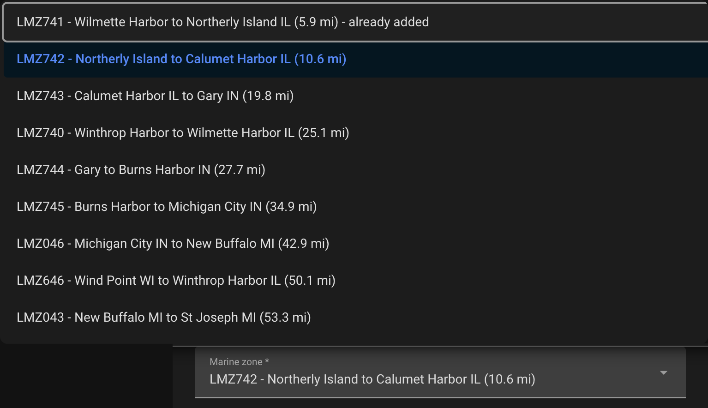

# Setup and configuration

Requires Home Assistant **2026.3.0** or newer. To install the integration, see the [README](../README.md#installation).

## Entries

The integration has five kinds of entry, each listed separately under **Settings → Devices & services → NOAA It All**:

| Entry | Title | Device |
|---|---|---|
| Weather for a location | `NOAA Weather - Wilmington, NC` | `NOAA ILM Weather` |
| Surf forecast for a coast | `NOAA Surf - Wilmington, NC` | `NOAA ILM Surf` |
| Nearshore marine forecast for a Great Lakes zone | `NOAA Marine - Wilmette Harbor to Northerly Island IL` | `NOAA LMZ741 Marine` |
| Space weather, aurora, meteor showers and eclipses | `NOAA Space - Wilmington, NC` | `NOAA ILM Space` |
| Hurricanes and satellite images | `NOAA Hurricane` | `NOAA Hurricane` |

<p align="left">

</p>

## Add a location

1. Go to **Settings** → **Devices & services** → **Add integration**, search for "NOAA It All", and choose **Weather for a location**.

   

2. Enter the **latitude and longitude** (required). They're pre-filled from your Home Assistant Home zone; change them to use another location. Observations come from the NWS station nearest to them, and alerts, forecasts and cloud cover use them too, as does the Space entry added in step 5.

   

3. Select your **NWS Forecast Office**. The office NWS names for your location is pre-selected (e.g., ILM for Wilmington, VEF for Las Vegas, BOU for Denver), followed by any coastal offices within 50 miles. If NWS can't be reached, only coastal offices are listed.

   

4. Choose a **surf forecast office**. Only coastal offices issue Surf Zone Forecasts, so this is the coast whose rip current risk, surf height and water temperature you want, added as its own `NOAA Surf` entry. The nearest is pre-selected; pick another to follow a beach you visit, or choose **No surf data**. Each office is listed with its distance and what it provides, e.g. `ILM - Wilmington, NC (4.0 mi) - rip current, water temp, surf height`:
   - Every office gives rip current risk. Water temperature needs a tide station and surf height a buoy; a new surf entry for an office without one doesn't get that entity, so nothing sits at unknown. See [NWS Forecast Offices](forecast-offices.md) for which offices have which.
   - **no forecast this week** means NWS hasn't issued one for that office in the last 7 days. Some offices, such as the Great Lakes ones, only issue them in their summer season.
   - **already added** means another entry already uses that office's surf entry, which is shared rather than added twice.

   

5. Choose **Space**: space weather, aurora, meteor showers and eclipses, as a `NOAA Space` entry for the forecast office, with a device named after it. `NOAA ILM Space - this location` adds it, worked out for this location. Each office has one Space entry:
   - **already added** means the office has one already. The location shares it, and it stays at its own location.
   - The other offices' Space entries are listed as **already added** too. Choosing one, or **No space data**, adds nothing.

   

6. Assign the device to an area, or choose **Skip and finish**. A weather entry has one device, `NOAA ILM Weather`. The surf and Space entries, and the hurricane entry on a first setup, are added alongside it.

   

A location set up as the integration's first entry also adds the `NOAA Hurricane` entry. Delete it if you don't want hurricane and satellite entities; nothing adds it back.

## Add more beaches, marine zones, Space or hurricanes

Use **Add entry** on the NOAA It All page and pick from the same menu. **Hurricanes and satellite images** is only offered while there's no `NOAA Hurricane` entry.

- **Surf forecast for a coast** lists every coastal office that doesn't have a surf entry yet, nearest to your Home zone first.

  

- **Nearshore marine forecast for a Great Lakes zone** asks for the lake, then the zone. With a Home zone set, the lakes are listed nearest first, with the distance to each lake's nearest zone, and the nearest lake is pre-selected.

  

  The next step lists that lake's zones nearest first, each with its zone ID and distance, and pre-selects the nearest one you haven't added. Zones you already have are marked **already added**. Without a Home zone, the lakes are listed west to east and the zones by zone ID, with no distances.

  

  Both steps end with **Other zone: enter its ID**, for a zone that isn't listed. To find a zone ID, open the zone's [marine forecast](https://forecast.weather.gov/shmrn.php?mz=lmz741) on weather.gov; the ID is in the page address (`mz=lmz741`). Either way, NWS supplies the zone's office and name, and setup checks the zone is in that office's Nearshore Marine Forecast. Open-lake and ocean zones aren't covered.

  

- **Space weather, aurora, meteor showers and eclipses** asks for a location, pre-filled from your Home zone, then its forecast office. Use it for aurora, meteor showers and eclipses somewhere other than your weather locations, such as a cabin near Marquette (`NOAA Space - Marquette, MI`, device `NOAA MQT Space`). Each office has one Space entry, so an office that has one is refused. So is a location NWS doesn't name an office for, as when NWS is down: try again later.

## Change a location

**Configure** (the gear on a `NOAA Weather` entry) walks through the latitude and longitude, the forecast office, then how many hours the radar loop covers (see [Radar loop history](#radar-loop-history)). Saving reloads the entry so the new values take effect immediately. Surf, marine, Space and hurricane entries have nothing to configure: add or delete them instead. A Space entry doesn't move with a weather entry; for a new office, add Space there and delete the old one.

| Option | Default | Notes |
|---|---|---|
| Latitude / Longitude | Home Assistant's Home location | Used for observations, forecasts, alerts and cloud cover |
| NWS Forecast Office | The office NWS names for those coordinates | Determines the entity IDs, radar site and forecast discussion |
| Hours of radar history | `24` | Length of the Radar Loop animation, `0`–`24` |

Changing the office creates the entities again under the new office code; see [Office Code Usage](entity-naming.md#office-code-usage).

<p align="left">

</p>

## Radar loop history

NOAA's own radar animation is fixed at ten frames covering roughly 50 minutes, and only those ten frames exist on its server — a longer loop cannot simply be downloaded. So the integration collects one frame per refresh and assembles the animation itself. The window defaults to **24 hours** and is set with **Configure** on the `NOAA Weather` entry:

- **`0`** — serve NOAA's own ~50 minute loop unchanged and store nothing on disk. This is how the
  integration behaved before version 0.6.0.
- **`1`–`24`** — build the loop locally over that window.

What to expect when it is on:

- **The loop fills in over time.** It starts at whatever history has been collected and reaches
  full length after that many hours of uptime. Until there are at least six frames, the card falls
  back to NOAA's own loop rather than showing a near-still image, so it is never blank.
- **Frames persist across restarts**, under `<config>/noaa_it_all/radar_frames/<RADAR_SITE>/`, one
  small GIF per scan. Expect a few megabytes per radar site. Frames outside the window are deleted
  on every refresh. The directory is removed when you delete the integration, when you switch the
  entry to a different forecast office, or when you set this option back to `0` — unless another
  configured office is still building a loop from the same radar site.
- **Frame spacing follows the window.** The animation is capped at 72 frames and plays through in
  about ten seconds, so a 24-hour loop steps every 20 minutes while a 6-hour loop keeps roughly one
  frame per radar scan.
- **The file is larger than NOAA's**, and every open dashboard re-downloads it whenever it changes.
  On a wall tablet on a mobile connection, prefer a shorter window.

While the buffer is still filling, each refresh makes two requests instead of one — the latest
frame, plus NOAA's loop to display in the meantime. That stops once enough frames have been
collected.

The Radar Loop entity exposes what it is actually doing as attributes:

| Attribute | Meaning |
|---|---|
| `loop_mode` | `local` when showing an animation built here, `upstream` when showing NOAA's |
| `loop_hours` | The configured window |
| `frame_count` | Frames in the animation currently being served |
| `window_start` / `window_end` | Times of its oldest and newest frames |

```yaml
# Alert when the radar loop quietly falls back to NOAA's short animation
template:
  - binary_sensor:
      - name: "Radar loop degraded"
        state: >
          {{ state_attr('image.noaa_ilm_weather_radar_loop', 'loop_mode') == 'upstream' }}
```

## Upgrading from 0.9.x

Upgrading moves each weather entry's `NOAA {OFFICE} Space` device into a `NOAA Space` entry for its office, at that entry's location, keeping the entity IDs and history. Weather entries in the same office share one Space entry. Going back to 0.9.x afterwards needs the integration removed and added again.

## Upgrading from 0.7.x

Upgrading splits each existing entry once: the location becomes a `NOAA Weather` entry, and its surf and the hurricane entities move to their own entries, keeping their entity IDs and history. Every surf entity you had is kept, including Water Temperature or Surf Height read from the forecast text where the office has no station. Reload the Home Assistant page afterwards so the new setup screens show. Going back to 0.7.x afterwards needs the integration removed and added again.

## Legacy YAML Configuration

> **Removed.** YAML configuration is no longer supported and creates **no entities**. If
> `noaa_it_all:` is present in `configuration.yaml`, the integration logs an error and sets nothing
> up. Remove the block and add the integration through **Settings → Devices & services → Add
> Integration → NOAA It All**.
