# Dashboard Card Examples

Each example is a card for **Edit dashboard → Add card → Manual**, and only uses cards that come with Home Assistant. The screenshots are from the Wilmington (ILM) setup; the alert and rip current cards are shown during a test Heat Advisory and high rip current risk.

> **Guard against startup, or your log will fill with tracebacks.** Home Assistant renders
> dashboard templates as soon as the frontend subscribes to them, which on a cold boot can be
> *before* this integration has registered its entities — the config entry awaits an initial
> refresh of its coordinators, all making live NWS calls, before any platform is set up. Until
> that finishes, `state_attr('sensor.noaa_…', 'periods')` returns `None` and
> `states.sensor.noaa_…` returns `None`, so an unguarded `[0]` or `` raises
> `TypeError: 'NoneType' object is not iterable` or `UndefinedError: None has no element 0`.
> The card recovers on the next render, but each attempt logs a full traceback, and it is
> intermittent — it depends on whether the templates lose the race that boot.
>
> Two habits avoid all of it:
>
> - **List attributes**: ``, then check
>   `` before indexing. The integration itself always publishes these
>   as lists, never `None` — a `None` means the entity is not there yet.
> - **`states.` objects**: bind first and test for truth —
>   `{{ … if s else '—' }}`.
>
> The examples below all do this.

## Weather Alerts Card (NOAA Weather Group)
```yaml
type: entities
title: "🚨 NWS Active Alerts - Wilmington"
show_header_toggle: false
state_color: true
entities:
  - entity: sensor.noaa_ilm_weather_active_nws_alerts
    name: "Active Alerts"
    icon: mdi:alert-circle
  - type: divider
  - entity: binary_sensor.noaa_ilm_weather_severe_weather_alert
    name: "Severe Weather"
    icon: mdi:weather-lightning
  - entity: binary_sensor.noaa_ilm_weather_flood_winter_alert
    name: "Flood/Winter"
    icon: mdi:weather-snowy-rainy
  - entity: binary_sensor.noaa_ilm_weather_heat_air_quality_alert
    name: "Heat/Air Quality"
    icon: mdi:sun-thermometer
  - entity: binary_sensor.noaa_ilm_weather_active_alerts
    name: "Any Active Alerts"
    icon: mdi:bell-alert
```
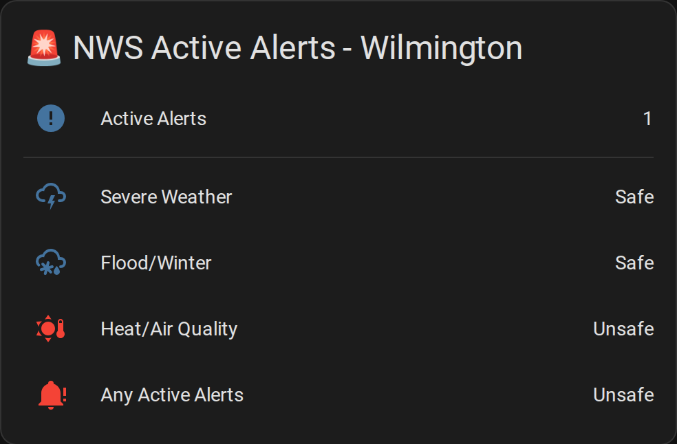

## Beach Conditions Card (NOAA Surf Group)
```yaml
type: entities
title: "🏖️ Beach Conditions - Wilmington"
show_header_toggle: false
state_color: true
entities:
  - entity: sensor.noaa_ilm_surf_rip_current_risk
    name: "Rip Current Risk"
    icon: mdi:waves
  - entity: binary_sensor.noaa_ilm_surf_unsafe_to_swim
    name: "Swimming"
    icon: mdi:swim
  - entity: sensor.noaa_ilm_surf_surf_height
    name: "Surf Height"
    icon: mdi:wave
  - entity: sensor.noaa_ilm_surf_water_temperature
    name: "Water Temperature"
    icon: mdi:thermometer-water
```
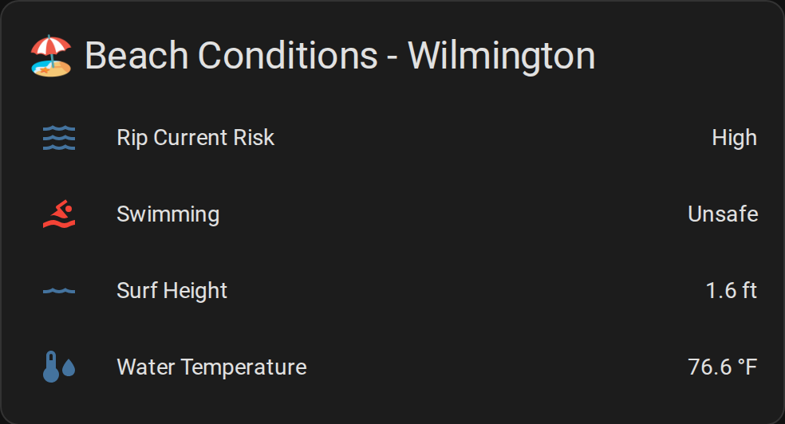

## Current Weather Card (NOAA Weather Group)
The next three forecast periods with NWS's icons. Home Assistant's markdown card drops inline styles, so the layout is a table.
```yaml
type: markdown
content: |
  
  
  <table>
  
  <tr><td></td><td><b>{{ p.name }}</b> · {{ p.temperature }}°{{ p.temperature_unit }}<br>{{ p.detailed_forecast }}</td></tr>
  
  </table>
  
  _Forecast loading…_
  
```
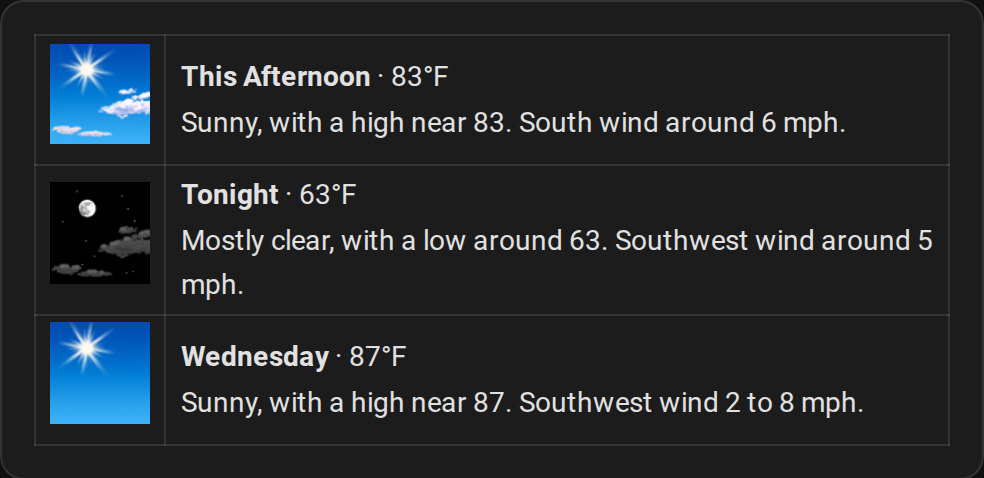

## Meteor Shower Card (NOAA Space Group)
```yaml
type: entities
title: ☄️ Meteor Showers
show_header_toggle: false
entities:
  - entity: binary_sensor.noaa_ilm_space_meteor_shower_active
    name: Worth Going Outside
  - entity: sensor.noaa_ilm_space_meteor_shower_activity
    name: Active Now
  - entity: sensor.noaa_ilm_space_meteor_viewing_score
    name: Viewing Score
  - type: attribute
    entity: sensor.noaa_ilm_space_meteor_viewing_score
    attribute: rating
    name: Conditions
  - type: attribute
    entity: sensor.noaa_ilm_space_meteor_viewing_score
    attribute: expected_per_hour
    name: Expected Meteors/Hour
  - type: attribute
    entity: sensor.noaa_ilm_space_meteor_viewing_score
    attribute: limiting_factor
    name: Limited By
  - type: divider
  - type: attribute
    entity: sensor.noaa_ilm_space_meteor_viewing_score
    attribute: best_window_start
    name: Best Viewing From
  - type: attribute
    entity: sensor.noaa_ilm_space_meteor_viewing_score
    attribute: best_window_end
    name: Best Viewing Until
  - type: attribute
    entity: sensor.noaa_ilm_space_meteor_viewing_score
    attribute: moon_illumination
    name: Moon Illumination
    suffix: "%"
  - type: divider
  - entity: sensor.noaa_ilm_space_next_meteor_shower
    name: Next Shower
  - type: attribute
    entity: sensor.noaa_ilm_space_next_meteor_shower
    attribute: days_until
    name: Days Away
```
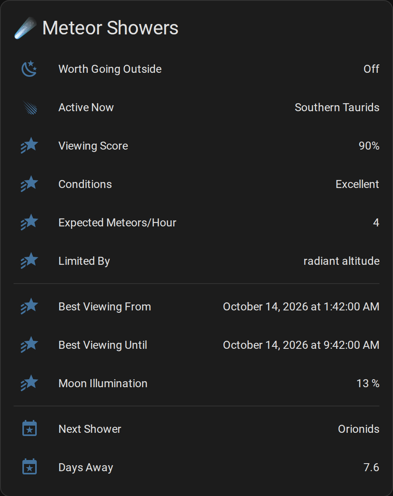

To list the upcoming showers, read the `upcoming` attribute with a markdown card:

```yaml
type: markdown
title: ☄️ Upcoming Meteor Showers
content: |
  
  
  **{{ s.name }}** — {{ as_timestamp(s.peak_local) | timestamp_custom('%b %-d') }} ({{ s.days_until | round(0) | int }} days), up to {{ s.zhr_max }}/hr in {{ s.constellation }}
  
```
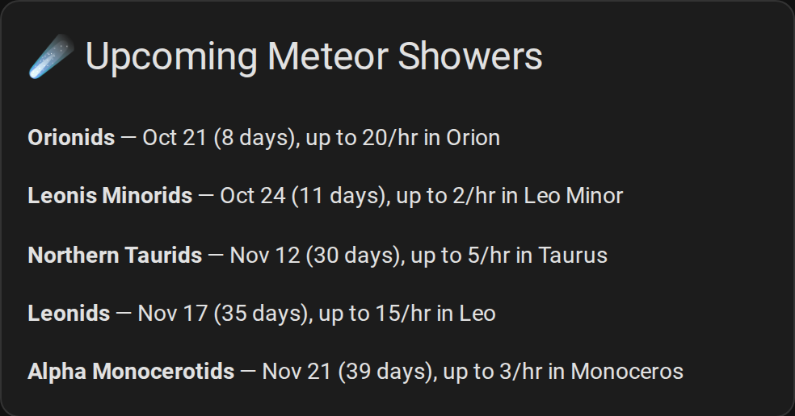

## Eclipse Card (NOAA Space Group)
```yaml
type: entities
title: 🌑 Eclipses
show_header_toggle: false
entities:
  - entity: binary_sensor.noaa_ilm_space_eclipse_visible_now
    name: Go Outside Now
  - entity: binary_sensor.noaa_ilm_space_eclipse_coming_up
    name: Worth Planning For
  - entity: sensor.noaa_ilm_space_next_eclipse
    name: Next Eclipse
  - entity: sensor.noaa_ilm_space_next_eclipse_time
    name: Go Outside At
  - entity: sensor.noaa_ilm_space_eclipse_coverage
    name: How Much You Get
  - entity: sensor.noaa_ilm_space_eclipse_viewing_score
    name: Viewing Score
  - type: attribute
    entity: sensor.noaa_ilm_space_eclipse_viewing_score
    attribute: rating
    name: Conditions
  - type: attribute
    entity: sensor.noaa_ilm_space_eclipse_viewing_score
    attribute: limiting_factor
    name: Limited By
  - type: divider
  - type: attribute
    entity: sensor.noaa_ilm_space_eclipse_viewing_score
    attribute: watch_from_local
    name: Watch From
  - type: attribute
    entity: sensor.noaa_ilm_space_eclipse_viewing_score
    attribute: watch_until_local
    name: Watch Until
  - type: attribute
    entity: sensor.noaa_ilm_space_eclipse_viewing_score
    attribute: look_towards
    name: Look Towards
  - type: attribute
    entity: sensor.noaa_ilm_space_eclipse_viewing_score
    attribute: altitude_when_visible
    name: Height Above Horizon
    suffix: "°"
  - type: divider
  - type: attribute
    entity: sensor.noaa_ilm_space_next_eclipse
    attribute: days_until
    name: Days Away
```
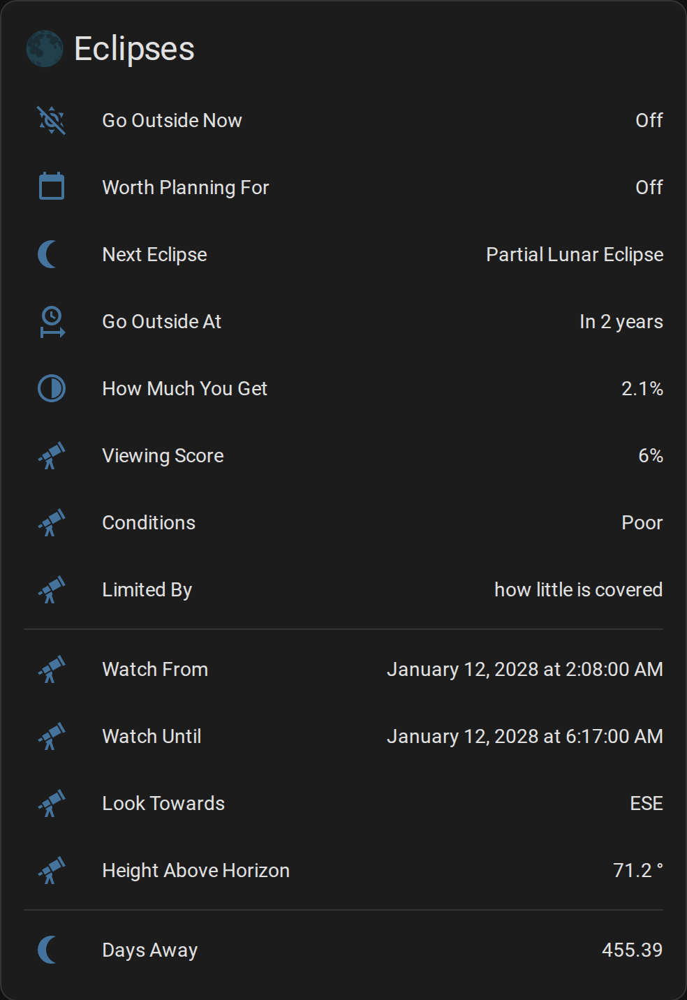

To list what is coming, read the `upcoming` attribute with a markdown card. It includes eclipses
that are *not* visible from your location, which is what stops the list from looking empty for
years at a time:

```yaml
type: markdown
title: 🌑 Upcoming Eclipses
content: |
  
  
  **{{ e.name }}** — {{ e.date }} ({{ e.days_until | round(0) | int }} days): {{ e.disc_covered }}% covered, score {{ e.viewing_score }}
  
```
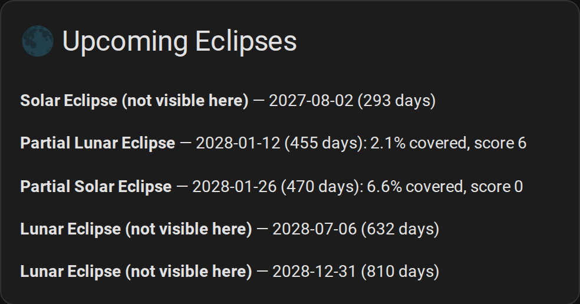

## Space Weather Card (NOAA Space Group)
```yaml
type: entities
title: 🌌 Space Weather
show_header_toggle: false
entities:
  - entity: sensor.noaa_ilm_space_planetary_k_index
    name: Kp Index
    icon: mdi:chart-line
  - entity: sensor.noaa_ilm_space_geomagnetic_storm_interpretation
    name: Geomagnetic Storm
    icon: mdi:earth
  - type: divider
  - entity: sensor.noaa_ilm_space_aurora_visibility_probability
    name: Aurora Probability
    icon: mdi:star-shooting
  - entity: sensor.noaa_ilm_space_aurora_next_time
    name: Next Aurora
    icon: mdi:clock-outline
  - entity: sensor.noaa_ilm_space_aurora_duration
    name: Duration
    icon: mdi:timer-outline
  - type: divider
  - entity: sensor.noaa_ilm_space_solar_radiation_storm_alerts
    name: Solar Radiation Alerts
    icon: mdi:radioactive
```
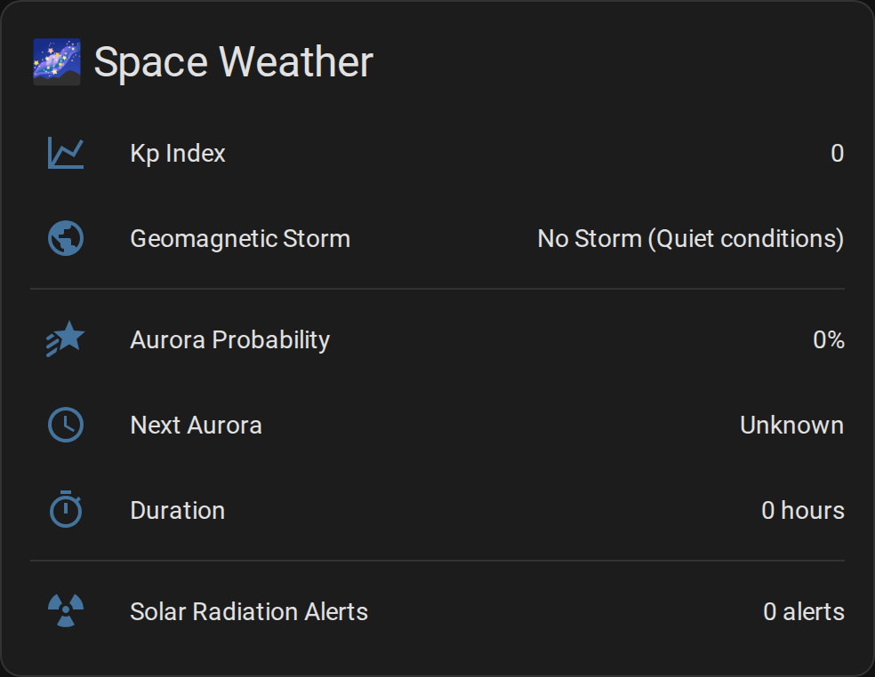

## Hurricane Tracking Card (NOAA Hurricane Group)
Activity covers every basin the NHC tracks, so the card lists the active storms from the `storm_details` attribute (intensity is in knots) and shows both outlook maps.
```yaml
type: vertical-stack
cards:
  - type: entities
    title: "🌀 Hurricane Activity"
    show_header_toggle: false
    entities:
      - entity: sensor.noaa_hurricane_activity
        name: "Activity Level"
        icon: mdi:weather-hurricane
      - entity: sensor.noaa_hurricane_alerts
        name: "Watches & Warnings"
        icon: mdi:alert-octagon
  - type: markdown
    content: |
      
      **{{ s.name }}** ({{ s.classification }}) — {{ s.intensity }} kt at {{ s.latitude }} {{ s.longitude }}
      
      No active storms.
      
  - type: horizontal-stack
    cards:
      - type: picture-entity
        entity: image.noaa_hurricane_outlook_image
        name: "Atlantic"
        show_state: false
      - type: picture-entity
        entity: image.noaa_hurricane_pacific_outlook_image
        name: "East Pacific"
        show_state: false
```
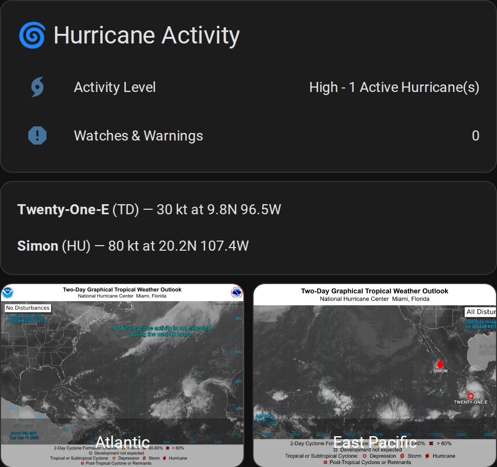

## Comprehensive Weather Dashboard View
Alerts and beach safety at the top only while they're active, then current conditions, details and the space weather images.
```yaml
type: vertical-stack
cards:
  # Top - alerts and beach safety, only while active
  - type: conditional
    conditions:
      - condition: state
        entity: binary_sensor.noaa_ilm_weather_active_alerts
        state: "on"
    card:
      type: markdown
      content: |
        <ha-alert alert-type="error" title="{{ state_attr('sensor.noaa_ilm_weather_active_nws_alerts', 'alert_count') }} active weather alert(s)">
        {{ (state_attr('sensor.noaa_ilm_weather_active_nws_alerts', 'alerts') or []) | map(attribute='event') | unique | join(', ') }}
        </ha-alert>
  - type: conditional
    conditions:
      - condition: state
        entity: binary_sensor.noaa_ilm_surf_unsafe_to_swim
        state: "on"
    card:
      type: markdown
      content: |
        <ha-alert alert-type="warning" title="High rip current risk">Swimming not recommended</ha-alert>

  # Current conditions
  - type: horizontal-stack
    cards:
      - type: gauge
        entity: sensor.noaa_ilm_weather_temperature
        name: "Temperature"
        # In °F; for °C, about min: -18, max: 49, green: 16 and yellow: 29
        min: 0
        max: 120
        severity:
          green: 60
          yellow: 85
          red: 95
      - type: gauge
        entity: sensor.noaa_ilm_weather_humidity
        name: "Humidity"
        min: 0
        max: 100
        severity:
          green: 30
          yellow: 60
          red: 80
      - type: gauge
        entity: sensor.noaa_ilm_space_planetary_k_index
        name: "Kp Index"
        min: 0
        max: 9
        severity:
          green: 0
          yellow: 5
          red: 7

  # Details
  - type: entities
    title: "Weather Details"
    entities:
      - entity: sensor.noaa_ilm_weather_feels_like
        name: "Feels Like"
      - entity: sensor.noaa_ilm_weather_wind_speed
        name: "Wind Speed"
      - entity: sensor.noaa_ilm_weather_barometric_pressure
        name: "Pressure"
      - entity: sensor.noaa_ilm_weather_sky_conditions
        name: "Sky"

  # Space weather images
  - type: horizontal-stack
    cards:
      - type: picture-entity
        entity: image.noaa_ilm_space_geoelectric_field_image
        name: "Geoelectric Field"
        show_state: false
      - type: picture-entity
        entity: image.noaa_ilm_space_aurora_forecast_image
        name: "Aurora Forecast"
        show_state: false
```
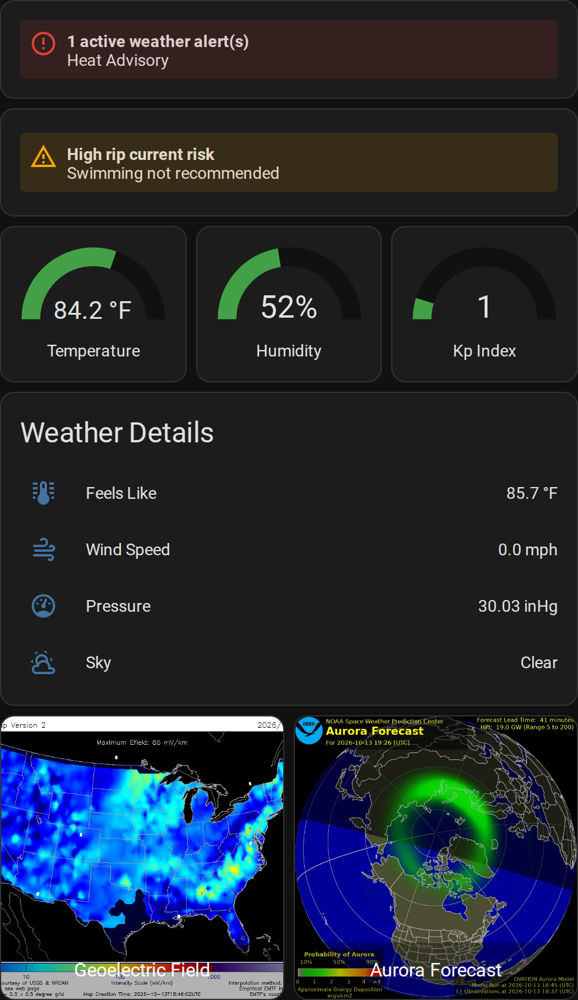

## Glance Card for Quick Overview
```yaml
type: glance
title: "NOAA Quick View"
show_name: true
show_state: true
columns: 4
entities:
  - entity: sensor.noaa_ilm_weather_temperature
    name: "Temp"
  - entity: sensor.noaa_ilm_weather_wind_speed
    name: "Wind"
  - entity: sensor.noaa_ilm_surf_surf_height
    name: "Surf"
  - entity: binary_sensor.noaa_ilm_surf_unsafe_to_swim
    name: "Swimming"
  - entity: sensor.noaa_ilm_space_planetary_k_index_rating
    name: "Kp"
  - entity: binary_sensor.noaa_ilm_weather_active_alerts
    name: "Alerts"
  - entity: sensor.noaa_hurricane_activity
    name: "Hurricanes"
  - entity: sensor.noaa_ilm_surf_rip_current_risk
    name: "Rip Risk"
```
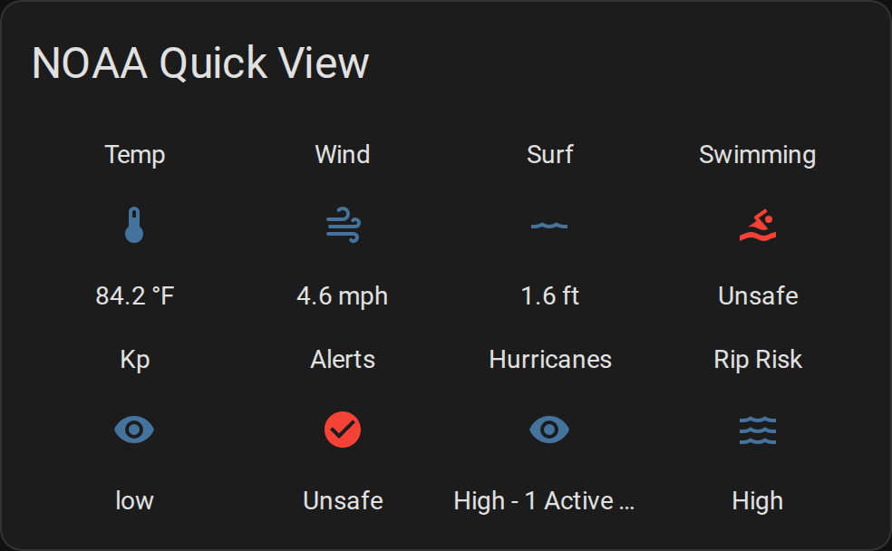

## Mobile-Optimized Card
```yaml
type: vertical-stack
cards:
  - type: markdown
    content: |
      # 📍 Wilmington Weather
      
      Updated: {{ as_timestamp(t.last_changed) | timestamp_custom('%-I:%M %p') if t else '—' }}
  - type: entities
    entities:
      - entity: sensor.noaa_ilm_weather_temperature
        name: "Temperature"
      - entity: sensor.noaa_ilm_weather_feels_like
        name: "Feels Like"
      - entity: sensor.noaa_ilm_weather_sky_conditions
        name: "Conditions"
  - type: conditional
    conditions:
      - condition: state
        entity: binary_sensor.noaa_ilm_weather_active_alerts
        state: "on"
    card:
      type: tile
      entity: sensor.noaa_ilm_weather_active_nws_alerts
      name: "View Active Alerts"
      icon: mdi:alert-circle
      color: red
```
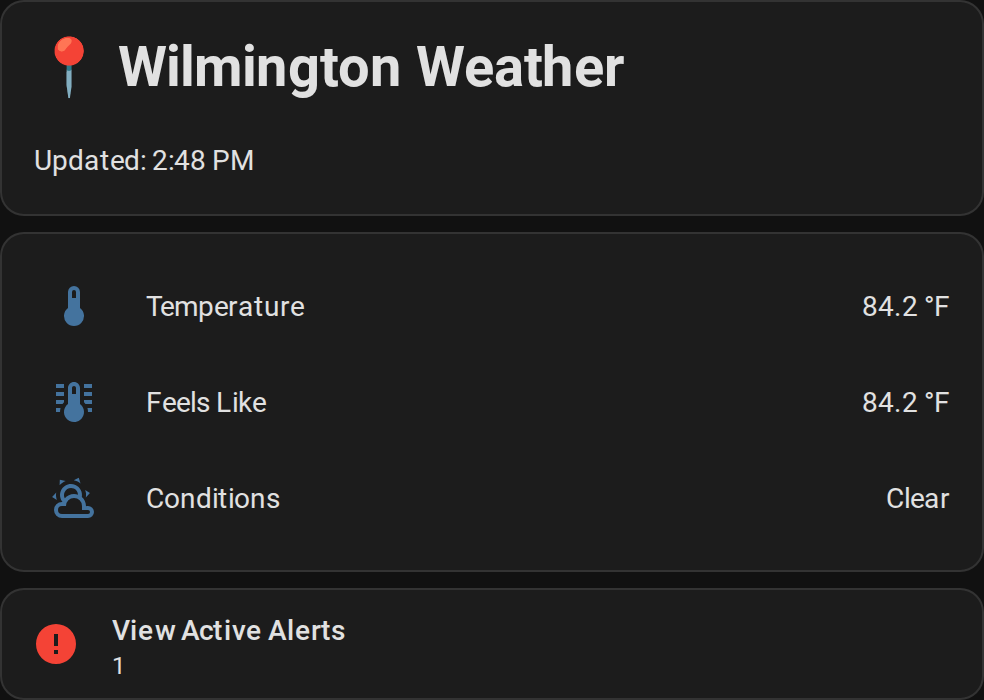

## Forecast Discussion Card
The discussion keeps NWS's line breaks in a code block. It's long, so give it a view or a popup of its own.
```yaml
type: markdown
title: "📝 Forecast Discussion"
content: |
  ~~~
  {{ state_attr('sensor.noaa_ilm_weather_forecast_discussion', 'full_text') or 'No discussion yet.' }}
  ~~~
```
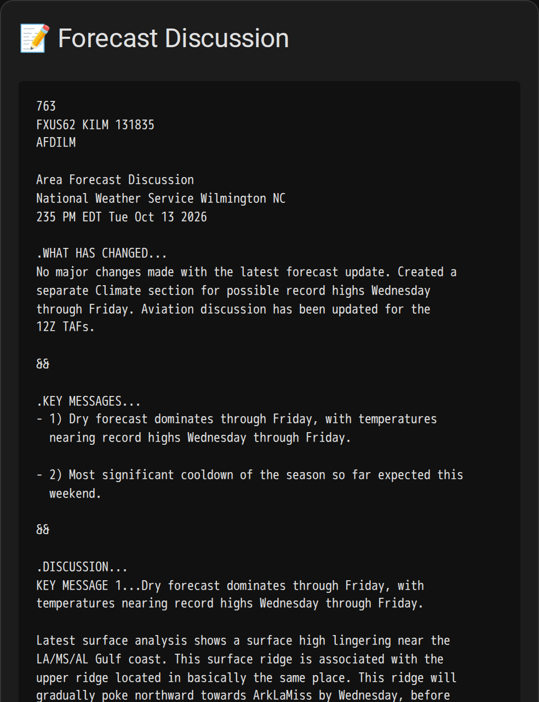

## Marine Forecast Card (NOAA Marine Group)
```yaml
type: markdown
title: "⛵ Wilmette Harbor to Northerly Island"
content: |
  
  
  **⚠️ {{ h }}**
  
  
  **{{ p.name }}**: {{ p.detailed_forecast }}
  
```
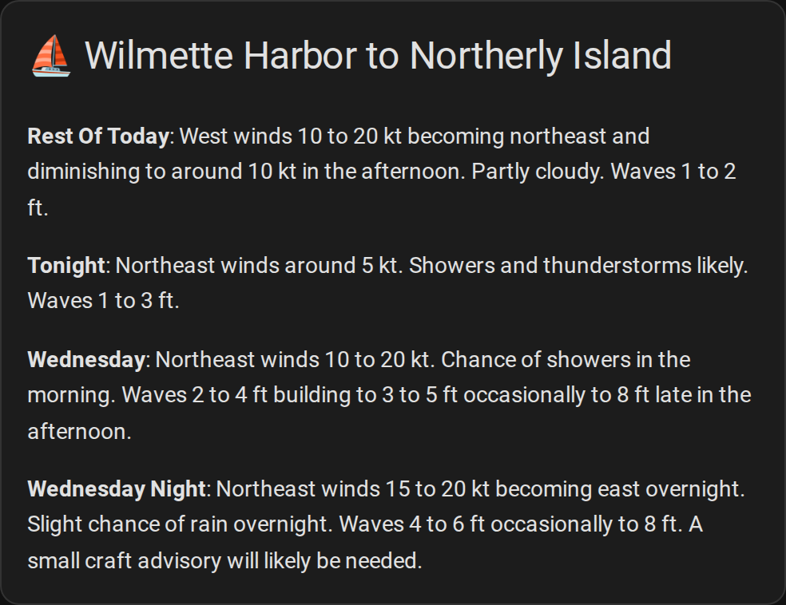
