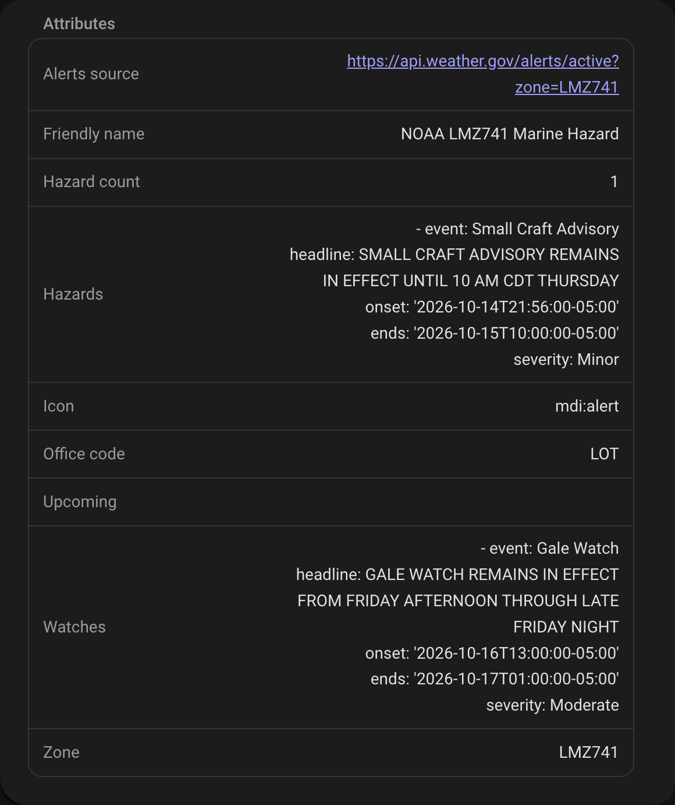

# Entities

## Entity Reference

Every entity, as created for the Wilmington (ILM) office and the `LMZ741` marine zone. Replace `ilm` with your office code and `lmz741` with your zone, in lower case. The sections after the tables describe each group in detail.

**NOAA {OFFICE} Weather** (22)

| Entity ID | State |
|---|---|
| `weather.noaa_ilm_weather` | Weather entity: condition, temperature and forecasts |
| `sensor.noaa_ilm_weather_temperature` | °F (°C)* |
| `sensor.noaa_ilm_weather_feels_like` | °F (°C)*, heat index or wind chill |
| `sensor.noaa_ilm_weather_humidity` | % |
| `sensor.noaa_ilm_weather_dewpoint` | °F (°C)* |
| `sensor.noaa_ilm_weather_wind_speed` | mph (km/h)* |
| `sensor.noaa_ilm_weather_wind_direction` | Degrees; `cardinal_direction` attribute |
| `sensor.noaa_ilm_weather_barometric_pressure` | inHg (hPa)* |
| `sensor.noaa_ilm_weather_visibility` | mi (km)* |
| `sensor.noaa_ilm_weather_sky_conditions` | Text, e.g. `Mostly Clear` |
| `sensor.noaa_ilm_weather_cloud_cover` | % |
| `sensor.noaa_ilm_weather_extended_forecast` | Number of periods, e.g. `14 periods` |
| `sensor.noaa_ilm_weather_hourly_forecast` | This hour's forecast temperature |
| `sensor.noaa_ilm_weather_forecast_discussion` | `Available`; text in attributes |
| `sensor.noaa_ilm_weather_active_nws_alerts` | Number of active alerts |
| `sensor.noaa_ilm_weather_radar_timestamp` | Time of the latest radar image |
| `binary_sensor.noaa_ilm_weather_severe_weather_alert` | On (Unsafe) during a severe weather alert |
| `binary_sensor.noaa_ilm_weather_flood_winter_alert` | On (Unsafe) during a flood or winter alert |
| `binary_sensor.noaa_ilm_weather_heat_air_quality_alert` | On (Unsafe) during a heat, air quality or fire alert |
| `binary_sensor.noaa_ilm_weather_active_alerts` | On (Unsafe) during any alert |
| `image.noaa_ilm_weather_radar_base_reflectivity` | Time of the image |
| `image.noaa_ilm_weather_radar_loop` | Time of the image |

\* The unit in a metric Home Assistant. See **Units** under [Current Weather Conditions](#current-weather-conditions).

**NOAA {OFFICE} Space** (20)

| Entity ID | State |
|---|---|
| `sensor.noaa_ilm_space_planetary_k_index` | Kp, 0–9 |
| `sensor.noaa_ilm_space_planetary_k_index_rating` | `low` (Kp under 2), `moderate` (2 to under 5) or `high` |
| `sensor.noaa_ilm_space_geomagnetic_storm` | Dst index in nT, e.g. `-13.2` |
| `sensor.noaa_ilm_space_geomagnetic_storm_interpretation` | `No Storm (Quiet conditions)`, `Minor Storm`, `Moderate Storm`, `Strong Storm` or `Severe Storm` |
| `sensor.noaa_ilm_space_aurora_visibility_probability` | % |
| `sensor.noaa_ilm_space_aurora_next_time` | Timestamp: start of the next forecast period with enough Kp here, or `unknown` |
| `sensor.noaa_ilm_space_aurora_duration` | Hours |
| `sensor.noaa_ilm_space_solar_radiation_storm_alerts` | Number of solar radiation storm warnings and alerts in effect |
| `sensor.noaa_ilm_space_meteor_shower_activity` | Shower most worth watching now, or `None` |
| `sensor.noaa_ilm_space_next_meteor_shower` | Next shower to peak |
| `sensor.noaa_ilm_space_meteor_viewing_score` | % |
| `binary_sensor.noaa_ilm_space_meteor_shower_active` | On when a shower is worth going out for |
| `sensor.noaa_ilm_space_next_eclipse` | Next eclipse visible here, e.g. `Partial Lunar Eclipse` |
| `sensor.noaa_ilm_space_next_eclipse_time` | Timestamp: when to go outside |
| `sensor.noaa_ilm_space_eclipse_coverage` | % of the disc covered |
| `sensor.noaa_ilm_space_eclipse_viewing_score` | % |
| `binary_sensor.noaa_ilm_space_eclipse_visible_now` | On from an hour before first contact to last contact |
| `binary_sensor.noaa_ilm_space_eclipse_coming_up` | On two weeks before an eclipse worth planning for |
| `image.noaa_ilm_space_geoelectric_field_image` | Time of the image |
| `image.noaa_ilm_space_aurora_forecast_image` | Time of the image |

**NOAA {OFFICE} Surf** (2 to 4)

| Entity ID | State |
|---|---|
| `sensor.noaa_ilm_surf_rip_current_risk` | `Low`, `Moderate` or `High` |
| `binary_sensor.noaa_ilm_surf_unsafe_to_swim` | On (Unsafe) when the rip current risk is high |
| `sensor.noaa_ilm_surf_water_temperature` | °F, if the office has a tide station |
| `sensor.noaa_ilm_surf_surf_height` | ft, if the office has a buoy |

**NOAA {ZONE} Marine** (3)

| Entity ID | State |
|---|---|
| `sensor.noaa_lmz741_marine_period` | Current forecast period, e.g. `Rest Of Today` |
| `sensor.noaa_lmz741_marine_forecast` | That period's forecast text |
| `sensor.noaa_lmz741_marine_hazard` | Most severe advisory or warning in effect, e.g. `Small Craft Advisory`, or `None` |

**NOAA Hurricane** (6)

| Entity ID | State |
|---|---|
| `sensor.noaa_hurricane_activity` | Activity level, e.g. `Quiet - No Active Storms or Alerts` |
| `sensor.noaa_hurricane_alerts` | Number of hurricane and tropical storm watches and warnings |
| `image.noaa_hurricane_outlook_image` | Time of the image (Atlantic) |
| `image.noaa_hurricane_pacific_outlook_image` | Time of the image (East Pacific) |
| `image.noaa_hurricane_goes_air_mass` | Time of the image |
| `image.noaa_hurricane_goes_geocolor` | Time of the image |

## Space Weather and Hurricane Sensors
- **Planetary K-index**: NOAA SWPC's estimated planetary Kp, from its 1-minute feed *(NOAA Space)*
- **Geomagnetic Storm**: The newest Dst index in nT, to one decimal, from SWPC's Geospace model, which gives a value a minute; the more negative, the stronger the storm. The model works from solar wind measured upstream of Earth, so its newest value is some 20 to 30 minutes ahead of now; the `timestamp` attribute is its time. It's `unknown` if the feed can't be fetched or its newest value is over two hours old. It keeps long-term statistics, so a history graph shows it as a line *(NOAA Space)*
- **Hurricane Alerts**: Number of active NWS hurricane and tropical storm warnings and watches *(NOAA Hurricane)*
- **Hurricane Activity**: Overall activity from the NWS alerts and the NHC's active storms. The state starts with the level, `Quiet`, `Low`, `Moderate` or `High`, followed by the reason, e.g. `High - 1 Active Hurricane(s)`. The `storm_details` attribute lists each active storm with its classification, intensity, position and movement *(NOAA Hurricane)*

## Surf Sensors
For the coastal office of a `NOAA Surf` entry *(NOAA {OFFICE} Surf)*:
- **Rip Current Risk**: Risk level (Low, Moderate, High) from the office's Surf Zone Forecast
- **Unsafe to Swim**: Binary sensor that turns on when the Surf Zone Forecast gives a high rip current risk; the `risk_level` attribute has the level
- **Water Temperature**: Water temperature in °F from the office's NOAA tide station. Only created for offices with one
- **Surf Height**: Wave height in feet from the office's NDBC buoy. Only created for offices with one

Rip Current Risk and Unsafe to Swim are `unknown` while the Surf Zone Forecast can't be fetched, rather than reading as safe. An entry upgraded from 0.7.x keeps any Water Temperature or Surf Height it had, read from the forecast text where the office has no station.

## Nearshore Marine Forecast
For the marine zone of a `NOAA Marine` entry, for example `LMZ741` on Lake Michigan *(NOAA {ZONE} Marine)*:
- **Period**: The current forecast period, such as `Rest Of Today` *(sensor.noaa_{zone}_marine_period)*
- **Forecast**: That period's forecast, such as `West winds 10 to 20 kt becoming northeast. Partly cloudy. Waves 1 to 2 ft.` *(sensor.noaa_{zone}_marine_forecast)*. The `periods` attribute lists every period as `name` and `detailed_forecast`, with any advisories in `headlines`

- **Hazard**: The most severe NWS advisory or warning in effect for the zone, such as `Small Craft Advisory` or `Gale Warning`, or `None` *(sensor.noaa_{zone}_marine_hazard)*. It comes from the zone's active NWS alerts, so it changes within minutes of NWS issuing, extending or cancelling one. Its attributes:
  - `hazards`: every advisory and warning in effect, most severe first, each with `event`, `headline` (NWS's own summary, such as `SMALL CRAFT ADVISORY IN EFFECT FROM 4 PM THIS AFTERNOON TO 10 AM CDT THURSDAY`), `onset`, `ends` and `severity`
  - `upcoming`: advisories and warnings already issued that haven't started yet, in the same form
  - `watches`: watches, such as a `Gale Watch`, which never set the state
  - `hazard_count`: how many are in effect

  Storm Warning outranks Gale Warning, which outranks Small Craft Advisory; NWS replaces one with the next as the wind strengthens. Statements, and alerts NWS has cancelled or replaced, are left out.

  

If the office hasn't issued a forecast in 24 hours, Period and Forecast are unavailable rather than showing an old one. The forecasts come from the Great Lakes offices' Nearshore Marine Forecast (NSH). Hazard is unavailable when NWS alerts can't be fetched, never `None`.

## NWS Active Weather Alerts
Real-time monitoring of National Weather Service alerts for your location *(NOAA {OFFICE} Weather)*:

**Binary Sensors:**
- **Severe Weather Alert**: Active tornado, thunderstorm, hurricane, or extreme wind warnings/watches *(binary_sensor.noaa_{office}_weather_severe_weather_alert)*
- **Flood/Winter Alert**: Active flood, winter storm, snow, ice, or freezing rain warnings/watches *(binary_sensor.noaa_{office}_weather_flood_winter_alert)*
- **Heat/Air Quality Alert**: Active heat, air quality, fire weather, or environmental advisories *(binary_sensor.noaa_{office}_weather_heat_air_quality_alert)*
- **Active Alerts**: General indicator for any active NWS alerts *(binary_sensor.noaa_{office}_weather_active_alerts)*

Each has `alert_count` and an `alerts` list with each alert's `event`, `headline`, `severity`, `urgency`, `certainty`, `area`, `effective`, `expires` and `description`. They use the `safety` device class, so Home Assistant shows them as **Safe** or **Unsafe**.

**Comprehensive Sensor:**
- **Active NWS Alerts**: The number of active alerts *(sensor.noaa_{office}_weather_active_nws_alerts)*, with:
  - `alert_count` and an `alerts` list with each alert's headline, description and instructions
  - `summary`: counts of warnings, watches, advisories and statements, and counts `by_severity` (Extreme, Severe, Moderate, Minor) and `by_urgency` (Immediate, Expected, Future)

> **Note**: Alert sensors update every 10 minutes and only include actual alerts (excludes test messages and drafts). All alerts are filtered to your configured latitude and longitude. The binary sensors and the comprehensive sensor are all on the NOAA {OFFICE} Weather device.

## Current Weather Conditions
Real-time weather observations from your local NWS observation station *(NOAA Weather)*:
- **Temperature**: Current temperature in °F (°C) *(sensor.noaa_{office}_weather_temperature)*
- **Humidity**: Relative humidity percentage *(sensor.noaa_{office}_weather_humidity)*
- **Wind Speed**: Wind speed in mph (km/h) *(sensor.noaa_{office}_weather_wind_speed)*
- **Wind Direction**: Wind direction in degrees with cardinal direction *(sensor.noaa_{office}_weather_wind_direction)*
- **Barometric Pressure**: Barometric pressure in inHg (hPa) *(sensor.noaa_{office}_weather_barometric_pressure)*
- **Dewpoint**: Dewpoint temperature in °F (°C) *(sensor.noaa_{office}_weather_dewpoint)*
- **Visibility**: Visibility distance in miles (km) *(sensor.noaa_{office}_weather_visibility)*
- **Sky Conditions**: Current sky conditions description (Clear, Cloudy, Fog, etc.) *(sensor.noaa_{office}_weather_sky_conditions)*
- **Feels Like**: Apparent temperature incorporating wind chill or heat index *(sensor.noaa_{office}_weather_feels_like)*

> **Note**: Weather observations update every 10 minutes from the NWS observation station nearest your configured coordinates. If that station stops answering, or has nothing from the last two hours, the next nearest (of up to three) is used until it comes back; the `station_id` attribute shows which one.
>
> **Units**: NWS reports observations in metric units, and Home Assistant shows them in your unit system: °F, mph, inHg and miles in a US customary install, °C, km/h, hPa and km in a metric one. You can pick another unit in an entity's settings. A sensor added before 0.10.3 keeps the unit it had, which was always US customary, until you change it there. The state has every decimal of the conversion and is rounded for display, so in templates use `states('sensor.noaa_ilm_weather_temperature', rounded=True)`, which gives `72.0` rather than `71.96000000000001`, and `with_unit=True` to add the unit.
>
> A missed reading doesn't blank a sensor. If NWS leaves a field such as humidity or wind out of the newest observation, it comes from the newest one in the last two hours that has it, and that sensor's `timestamp` attribute says when it was observed. If every station fails, the last observation stays for up to an hour after the last successful refresh before the observation entities go `unavailable`. Wind direction, wind chill and heat index come from the same observation as the wind speed or temperature they go with: NWS leaves direction empty for calm or variable wind, and wind chill and heat index whenever they don't apply.

## Aurora Visibility Alerts
Location-aware aurora visibility predictions *(NOAA Space)*:
- **Aurora Next Time**: When aurora may next be visible at your location, from SWPC's 3-day Kp forecast *(sensor.noaa_{office}_space_aurora_next_time)*. The state is the start of the next 3-hour forecast period whose forecast Kp reaches the Kp your location needs; the period in progress doesn't count, as Aurora Visibility Probability goes by the Kp measured now. It is `unknown` when no period in the forecast reaches it, or the forecast can't be fetched. The forecast doesn't know about daylight, so a period during the day means after dark at the earliest. Attributes: `predicted_kp` (that period's forecast Kp), `required_kp`, `current_kp` and `magnetic_latitude`
- **Aurora Duration**: Estimated length of aurora visibility in hours based on geomagnetic conditions *(sensor.noaa_{office}_space_aurora_duration)*
- **Aurora Visibility Probability**: Percentage chance of aurora visibility from your specific location *(sensor.noaa_{office}_space_aurora_visibility_probability)*

> **Note**: Aurora Duration and Aurora Visibility Probability are based on the current Kp index, and Aurora Next Time on SWPC's Kp forecast, each with the magnetic latitude of the Space entry's office (for the coastal offices) or of its location (for any other office). Northern locations (like Duluth, MN) have much higher visibility potential than southern locations (like Miami, FL).

## Solar Radiation Storm Alerts
Location-aware monitoring of solar radiation storm activity *(NOAA Space)*:
- **Solar Radiation Storm Alerts**: The number of SWPC solar radiation storm (S1-S5) warnings and alerts in effect *(sensor.noaa_{office}_space_solar_radiation_storm_alerts)*. These are SWPC's 10 MeV proton products: a warning counts until its valid time ends, unless SWPC extends or cancels it, and an alert counts until SWPC issues the event's summary, with one alert at most for each of S1 to S4. SWPC's other alerts, such as radio emissions, electron flux and the 100 MeV proton flux, which has no S-scale, don't count. If the alerts can't be fetched, the sensor is `unknown`
  - **Storm Classification**: The S1-S5 scale of each warning and alert in the `alerts` attribute
  - **Expected Timing**: When each alert's event began, and the times each warning is valid from and to
  - **Impact Assessment**: Potential impacts including satellite interference, radio blackouts, and radiation exposure risks
  - **Location Risk**: Risk assessment based on your magnetic latitude and current storm activity

> **Note**: Solar radiation storm impacts vary by location and magnetic latitude. Higher latitudes (like Alaska and northern Canada) experience more severe effects, while equatorial regions are generally less affected. The integration provides location-specific risk assessments for your configured NWS office.

## Meteor Showers
Meteor shower alerts and a viewing forecast for your exact location *(NOAA Space)*:

- **Meteor Shower Activity**: The shower most worth watching right now, or `None` *(sensor.noaa_{office}_space_meteor_shower_activity)*
  - Attributes include the current ZHR, peak time in your local timezone, radiant altitude, parent body, and a list of every shower currently active
- **Next Meteor Shower**: The next shower to reach maximum *(sensor.noaa_{office}_space_next_meteor_shower)*
  - The `upcoming` attribute holds the next five showers with peak dates — this is what dashboard "what's coming up" cards read from
- **Meteor Viewing Score**: How good tonight's sky is, 0–100% *(sensor.noaa_{office}_space_meteor_viewing_score)*
  - Attributes include `rating`, `best_window_start`/`best_window_end` (when to actually go outside), `expected_per_hour`, `moon_illumination`, `moon_altitude`, `darkness`, and `limiting_factor`
- **Meteor Shower Active**: Turns on when a shower is genuinely worth going outside for *(binary_sensor.noaa_{office}_space_meteor_shower_active)*
  - Requires both a real predicted rate (≥5/hour) and usable sky conditions (score ≥25), so it stays off most nights instead of sitting permanently on
  - Measured over 2026 from Wilmington NC that is about 50 nights, clustered around the major showers (~13 for the Perseids, 8 for the Orionids, 7 for the Geminids) — the Perseids really do stay above 5/hour for roughly six days either side of maximum

> **Note on the data source**: NOAA publishes no meteor shower data, and neither does anyone else as a live feed — none is needed. Earth crosses the same debris streams at the same point in its orbit every year, so this feature ships a catalog of ~29 showers keyed by **solar longitude** and computes each year's peak time locally. There is no API call, no API key, and no extra dependency, and it keeps working with no internet connection. Computed peak times are accurate to about ±11 minutes, which is far finer than the hours-wide spread of real shower maxima.

> **Note on the score**: The viewing score measures *sky conditions*, not shower strength — it is the fraction of the ideal meteor rate you would actually achieve, so a minor shower riding high under a new moon scores well while the Perseids behind a full moon score badly. Shower strength is reported separately as `expected_per_hour`. The score accounts for radiant altitude, moonlight and astronomical darkness. It does **not** account for cloud cover; pair it with `sensor.noaa_{office}_weather_cloud_cover` if you want that.

## Solar and Lunar Eclipses
Eclipse alerts and a viewing forecast for your exact location *(NOAA Space)*:

- **Next Eclipse**: The next eclipse visible from where you are, named the way *you* will see it *(sensor.noaa_{office}_space_next_eclipse)*
  - Attributes include the local start/maximum/end times, how much of the disc you get, where to look, and an `upcoming` list of the next five
- **Next Eclipse Time**: When to go outside — a real timestamp, so Home Assistant shows "in 3 days" or "8:29 PM" and a time trigger can fire straight off it *(sensor.noaa_{office}_space_next_eclipse_time)*
  - The moment the eclipse has begun **and** the Sun or Moon is above your horizon, which for an eclipse already under way at moonrise is moonrise. Attributes carry the end of the window, maximum, totality window, and `look_towards`
  - `unknown` when no eclipse is due, which for a timestamp is the honest answer
- **Eclipse Coverage**: How much of the Sun or Moon you will actually see covered, 0–100% *(sensor.noaa_{office}_space_eclipse_coverage)*
  - This is the "will I get 29% or the whole thing" number
- **Eclipse Viewing Score**: How worthwhile it is from here, 0–100% *(sensor.noaa_{office}_space_eclipse_viewing_score)*
  - Attributes include `rating`, `watch_from_local`/`watch_until_local`, `look_towards`, the totality window, `limiting_factor`, and the eye-safety notice
- **Eclipse Visible Now**: Turns on an hour before first contact and off at last contact *(binary_sensor.noaa_{office}_space_eclipse_visible_now)*
  - The one to trigger an announcement from. Expect it on for a few hours a year at most, and in many years not at all
- **Eclipse Coming Up**: Turns on two weeks before an eclipse worth planning around *(binary_sensor.noaa_{office}_space_eclipse_coming_up)*
  - A higher bar than the live alert: a partial eclipse worth glancing at is not one worth booking the day off for

> **⚠️ Eye safety**: Never look at a partially eclipsed Sun without ISO 12312-2 eclipse glasses or a certified solar filter — sunglasses, exposed film and smoked glass are **not** safe. Only during **totality**, between second and third contact, may the Sun be viewed with the naked eye, and the filter goes back on the instant the first sliver reappears. An **annular** eclipse is never safe to view unfiltered: there is still a complete ring of photosphere at maximum. Every solar entity carries `eye_protection_required`, `safe_without_filter` and an `eye_safety` string so an automation can read the warning out.

> **Note on "your" eclipse**: A total solar eclipse is total along a strip a couple of hundred kilometres wide and merely partial across a whole continent either side of it. Everything here reports the eclipse **you** get — a 43% partial is reported as a partial eclipse, with the headline classification kept alongside as `global_type`. Likewise `disc_covered`, the viewing score and `look_towards` are all measured at the best moment the Sun or Moon is actually above your horizon, so a site where the body sets mid-eclipse is not advertised a maximum that happens underground, or pointed at a horizon the Moon has already set behind. `visible_fraction` says how much of the event you get at all, and `altitude_at_maximum` still reports the geometric peak for reference.

> **Note on the two percentages**: `disc_covered` is the fraction of the disc's **area** that is hidden. Eclipse *magnitude*, the figure usually quoted, is the fraction of its **diameter**, and the two are far apart — magnitude 0.5 is only 39% covered. Both are reported so you can compare against a published table.

> **Note on the data source**: Lunar eclipses are computed from first principles and stay correct indefinitely. Solar eclipses need Besselian elements from full planetary ephemerides, so this feature bundles NASA's for **2025–2075** — 114 eclipses — and does the observer-specific geometry locally. There is no API call, no API key and no extra dependency, and it keeps working with no internet connection. Computed contact times land within 20 seconds of NASA's published values, checked against all 114. Regenerate or extend the catalog with `python3 scripts/build_eclipse_catalog.py`. *Eclipse Predictions by Fred Espenak, NASA's GSFC.*

> **Note on the score**: Unlike the meteor viewing score this deliberately does **not** factor out the strength of the event — whether the Moon covers a tenth of the Sun or all of it is the single most important thing about a solar eclipse. It accounts for how much is covered, how high the Sun or Moon sits, and for lunar eclipses how dark the sky is. It does **not** account for cloud cover; pair it with `sensor.noaa_{office}_weather_cloud_cover` if you want that.

## Optional Secondary Sensors
These sensors provide additional weather data where available from NOAA/NWS *(NOAA Weather)*:

- **Cloud Cover**: Current cloud coverage percentage from NWS gridpoint data *(sensor.noaa_{office}_weather_cloud_cover)*
  - Returns percentage (0-100%) of sky covered by clouds
  - Updated from forecast gridpoint data for your location
  - Requires latitude/longitude configuration
  - May not be available for all locations

- **Radar Timestamp**: Timestamp of the latest radar image for your NWS office *(sensor.noaa_{office}_weather_radar_timestamp)*
  - Shows when the most recent radar image was captured
  - Useful for automations or displaying radar freshness
  - Based on the NEXRAD radar site for your location, which NWS names during setup
  - Not created if no radar site is known for the office

- **Forecast Discussion**: Meteorologist-written forecast discussion (AFD product) *(sensor.noaa_{office}_weather_forecast_discussion)*
  - Detailed technical analysis from local NWS meteorologists
  - Includes reasoning behind forecast decisions
  - Updated when new forecast discussions are issued (typically 2-3 times daily)
  - State is the literal `Available` (or unknown); the text is in the `full_text` attribute,
    and `summary` has its first 200 characters. `issue_time` is when it was issued, e.g.
    `235 PM EDT Tue Oct 13 2026`
  - Provides insight into weather patterns and forecast confidence

## Forecast Sensors and the Weather Entity

- **Extended Forecast**: Multi-day NWS forecast *(sensor.noaa_{office}_weather_extended_forecast)*.
  The state is the number of periods; the `periods` attribute lists each one with `name`,
  `start_time`, `temperature`, `temperature_unit`, `wind_speed`, `wind_direction`,
  `short_forecast`, `detailed_forecast` and `icon`
- **Hourly Forecast**: Hour-by-hour NWS forecast *(sensor.noaa_{office}_weather_hourly_forecast)*.
  The state is this hour's temperature; `current_hour` has this hour and `hourly_periods` the
  next 48, each with `precipitation_probability` as well
- **Weather**: A full Home Assistant weather entity backed by NWS observations and forecasts
  *(weather.noaa_{office}_weather)* — use this with the standard Weather Forecast card, and with
  `weather.get_forecasts` in templates. Note the single `weather` in the ID, not `_weather_weather`.
  Its daily forecast has one entry per date, with the day's high and the following night's low.
  In the evening, when NWS no longer forecasts today's high, today's entry has only tonight's low
  and its `temperature` is empty.

## Derived Space Weather Sensors

- **Geomagnetic Storm Interpretation**: Plain-language reading of the newest Dst value
  *(sensor.noaa_{office}_space_geomagnetic_storm_interpretation)*
- **Planetary K-Index Rating**: Plain-language reading of the Kp value
  *(sensor.noaa_{office}_space_planetary_k_index_rating)*

> **Note**: These sensors gracefully handle missing data by returning `None` or `Unknown` when data is unavailable. The `availability` attribute indicates data source and current status. **UV Index is NOT available** through NWS APIs and cannot be provided by this integration.

## Image Entities
Visual representations of current conditions:

**NOAA {OFFICE} Space** (global images, one set per Space entry):
- **Geoelectric Field Image** — Real-time geoelectric field map from SWPC *(image.noaa_{office}_space_geoelectric_field_image)*
- **Aurora Forecast Image** — SWPC's aurora forecast map for the northern hemisphere *(image.noaa_{office}_space_aurora_forecast_image)*

**NOAA Hurricane** (global, created once):
- **Outlook Image** — 2-day tropical weather outlook from NHC, **Atlantic basin** *(image.noaa_hurricane_outlook_image)*
- **Pacific Outlook Image** — the same 2-day outlook for the **East Pacific basin** *(image.noaa_hurricane_pacific_outlook_image)*
- **GOES Air Mass** — GOES-19 Air Mass RGB satellite imagery *(image.noaa_hurricane_goes_air_mass)*
- **GOES Geocolor** — GOES-19 GeoColor satellite imagery *(image.noaa_hurricane_goes_geocolor)*

**NOAA {OFFICE} Weather** (one set per weather entry):
- **Radar Base Reflectivity** — Latest NEXRAD base reflectivity radar for your NWS office *(image.noaa_{office}_weather_radar_base_reflectivity)*
- **Radar Loop** — Animated NEXRAD radar loop, covering up to 24 hours *(image.noaa_{office}_weather_radar_loop)*

> **Radar loop history**: NOAA's own radar animation covers roughly 50 minutes, so the integration builds a longer loop itself, 24 hours by default. [Radar loop history](configuration.md#radar-loop-history) covers the setting, what to expect while it fills in, the disk it uses and the entity's `loop_mode` attributes.

> **Tip**: Image entities can be displayed on dashboards using the standard `picture-entity` or `picture-glance` cards.
>
> Home Assistant fetches each image from NOAA in the background every 10 minutes and serves it to the browser through its own image proxy (`/api/image_proxy/...`), so the dashboard does not talk to NOAA directly. The most recently fetched frame is kept in memory: if NOAA is briefly unreachable the card keeps showing the last good image rather than going blank, and the outage is logged quietly unless it persists. Each entity's state is the timestamp of the image currently being served, so you can alert on an image going stale.
